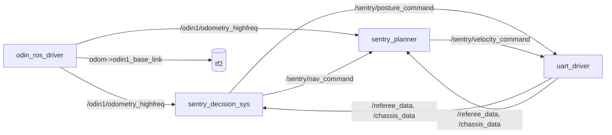

# SentryMaster 2026 参赛分析与学习路径

> 基于对 `rulev1.2.pdf`(v1.2, 2026-10-4)、工作空间 `README.md`、全部源码、地图 PCD、odin 驱动与串口协议，以及社区开源哨兵方案的调研整理。
>
> v1.2 相对 v1.1 有 3 处实质改动 + 地图区域划分图更新（得分效率乘积关系、补给区"离开 5 m"约束、地堡中央稳定停留），详见 §一。

---

# 一、规则提炼：这场比赛算法到底要干什么

规则要点（来自 `rulev1.2.pdf` v1.2）：

| 项 | 内容 |
|---|---|
| 形态 | 四舵轮哨兵，600³ mm，底盘功率上限 100 W，5 分钟全自动（遥控器只用于切自动模式） |
| 得分① | 每分钟回补给区停留 5 s → 20 分/分钟（最多约 5 次）；**每分钟必须先离开补给区 ≥5 m 再回来才算一次**（v1.2 新增） |
| 得分② | 前 3 分钟，经**起伏路段**上中央高地、正中停留 20 s → 100 分（一局限一次） |
| 得分③ | 前 3 分钟，经基地区斜坡上梯形高地停留 20 s → 50 分（一次） |
| 得分④ | 最后 2 分钟到**地堡**停留 20 s 且保持小陀螺 → 80 分（一次）；**地堡存在斜坡，必须稳定停在地堡中央，在斜坡上会清空计时**（v1.2 新增） |
| 得分⑤ | 从补给区出发前往 ②③④ 途中全程开底盘小陀螺（斜坡/起伏路段可关）→ 额外 +20 |
| 得分⑥ | 预检录评级 A/B/C/D → 每局初始分 +20/0/−20/−40 |
| 姿态 | 移动姿态：功率上限 ×1.5；得分姿态：功率上限降到 1/2、得分效率 ×1.5；切换冷却 5 s；**单一姿态累计超 3 分钟效果降级**（×1.2） |
| 得分效率（v1.2 明确） | 得分姿态的 ×1.5 与 §5.4 各得分手段（**除评级得分外**）是**乘积关系**；规则只给了①的示例：20×1.5=30。②③④ 按乘积推理为 150/75/120，⑤的 +20 是否也乘 1.5 需答疑确认 |
| 能量 | 初始 20000，耗尽进入节能态（功率上限 35 W） |
| 胜负 | 总分高者胜；平分 → 底盘耗能多者胜；再平 → 加赛 |

**v1.2 相对 v1.1 的实质变更（2026.10.4）**：

1. §5.2 新增：得分姿态的得分效率 ×1.5 与 §5.4 各得分手段（**除评级得分外**）是**乘积关系**——规则原文示例：①基础分 20 × 1.5 = 实际 +30。
2. §5.4① 新增约束：每分钟的补给区得分**必须"离开补给区至少 5 m 再回来"**才算一次——赖在补给区附近刷时间是无效的。
3. §5.4④ 新增约束：地堡**存在斜坡**，必须**稳定停在地堡中央**，**在斜坡上会清空计时**（20 s 计时可被打断重来）。
4. §4.3.1 / §4.4.1 文字调整 + **地图区域划分图更新**：打点、区域边界、禁小陀螺区一律以 v1.2 的图（Figure 7/8/10 等）为准。

**关键工程结论**：裁判系统给算法的数据只有 `game_time` 和当前 `sentry_posture`（见 `RefereeData.msg` 与 `struct_def.hpp`），**没有得分、没有能量、没有位置**。所以决策必须是"自维护时间轴 + 用里程计自测位置"的开环调度器；你无法从裁判数据里知道"这一项拿到分了没有"，只能用时间和位置自己判定。

v1.2 的两条新约束**都没有新增反馈数据**：补给区的"离开 5 m"只能由决策自己用里程计记录"本次补给停留后是否已离开 ≥5 m"（建议按 6 m 留余量，别卡在 5.0），否则该分钟不计分；地堡的"中央稳定停留 / 斜坡清零计时"对导航的驻留精度提出更高要求（停不稳 → 计时反复清零 → 20 s 永远攒不够）。

另外注意：这套规则里**没有射击、没有伤害、没有视觉目标**——RM 强队哨兵的那套自瞄/装甲板/弹道学习这里完全不需要，别把时间花在那。核心只剩三件事：**定位导航、任务调度（决策）、姿态/能量管理**。

---

# 二、仓库现状：已给什么、缺什么

| 包 | 已有 | 缺 |
|---|---|---|
| `rm_msgs` | `RefereeData`(game_time, sentry_posture)、`ChassisData`(vx,vy,wz) | 3 个新 msg（README §2） |
| `uart_driver` | 收串口 → 发 `/referee_data`、`/chassis_data`；`struct_def.hpp` 已定义 `ChassisControl`(id 0x20) 与发送示例 | **发送链路完全没接**：无订阅者、无定时器、`send_serial_packet` 是私有的、无调用点 |
| `sentry_decision_sys` | Python 节点，订阅裁判/里程计/底盘，TF listener 已建 | 回调全空，无任何 publisher |
| `sentry_planner` | C++ 节点，订阅里程计/底盘，TF buffer；CMake 已声明 PCL/OMPL/OpenCV/fmt | 回调全空，未订阅决策指令，无速度发布 |
| 基础设施 | odin 驱动（`/odin1/odometry_highfreq` 等）、URDF（`odin1_base_link→vehicle`，含安装偏置）、`map.pcd`（实测包围盒 x∈[1.4,16.5]、y∈[1.1,13.8]、z∈[0.1,4.1] m）、500×500 二值 PNG | 地图与 odom 的对齐关系、任务点坐标 |

**几个必须知道的事实/坑**：

1. `chassis.launch.py` 里 `uart_driver` 和 `odin1` 的 include 是**注释掉的**（只有 planner/decision/robot_state_publisher 会起）。
2. `struct_def.hpp` 注释：`1/2 得分姿态 3 移动姿态`；planner 里还有个旧枚举 `ATTACK=1, DEFENSE=2, MOVE=3`。规则只有两种姿态，**"1 和 2 到底是不是同一个得分姿态"需要跟电控/哨兵组确认**（规则 §1.2 有答疑渠道，建议第一批就问）。
3. 串口帧格式：`0x7D | id | payload | CRC16(2) | 0x7E`，帧内字节 0x7D/0x7E/0x7F 用 `0x7F | (b-0x7D)` 转义（`serial_trans_tool.hpp`），收端 `b+0x7D` 还原。`trans_uint8_struct` **CRC 校验失败会返回全零结构体，但 `transfer.cpp` 照样发布** → 决策会收到"game_time=0"的假数据，要做有效性判断。
4. vendored `serial` 库无内部锁；读在独立线程、发送在定时器线程，建议自己加互斥（并发 read/write 同一 fd 在 POSIX 下基本安全，但别两处同时写）。
5. odin 驱动有三种模式（`config/control_command.yaml`）：`custom_map_mode: 0 里程计 / 1 SLAM / 2 重定位`，重定位模式需要设备格式的地图文件路径 `relocalization_map_abs_path`。**`map.pcd` 能否直接用于重定位、比赛用哪种模式，是最大的待确认项**。`info.md` 写"场地范围 ±25 m"与实际 PCD 包围盒不符，不要信。
6. `sentry_planner/CMakeLists.txt` 用 `GLOB_RECURSE src/*.cpp`：新增 cpp 自动纳入编译，不用改 CMake。已声明 OMPL/PCL/OpenCV/fmt —— 这就是"官方暗示"的实现工具集，优先用它们，别引入官方平台可能没装的重依赖（本机 kilted 目前就没装 nav2/pcl_ros/ompl，`ros-kilted-ompl`、`ros-kilted-pcl-ros`、`libfmt-dev` apt 可装）。

---

# 三、需求分析（README §2 第 1 项要求的产出）

| 比赛任务 | 需要的基础控制接口 | 由哪个节点得出 | 数据来源 |
|---|---|---|---|
| 到某区域（补给区/高地/地堡）并停留 N 秒 | ① 点到点导航：目标点 (x,y,yaw) ② 驻留（位置保持）③ 到达/驻留计时 | 决策出**指令**（哪去、待多久、要不要转），导航出**速度**（vx,vy,wz） | 里程计位姿 + `game_time` |
| 补给区"离开 ≥5 m 再回来"（得分①，v1.2） | 无新接口：决策用里程计自测"离补给点的最远距离"标志；导航需要一个离补给点 ≥6 m 的**拉出点**航点 | 决策（判定）+ 导航（执行拉出点） | 里程计位姿 |
| 地堡"中央稳定停留、斜坡清零计时"（得分④，v1.2） | 更严的到位判定 + 驻留位置保持（不得停在斜坡上） | 导航（驻留精度）+ 决策（到位/稳定判据） | 里程计位姿 + 底盘速度 |
| 途中/驻留小陀螺（得分⑤、得分④） | 底盘自旋角速度分量（与平移解耦） | 导航（按决策的 spin 标志叠加 wz） | 里程计 yaw |
| 姿态切换（移动↔得分，含 5 s 冷却、3 分钟累计限制） | 姿态指令 | 决策 | `game_time`、当前姿态（裁判回传） |
| 能量管理（防进节能态；平分时耗能多者胜） | 无直接接口 → 只能通过速度/加速度上限间接影响 | 导航（速度/加速度限幅）+ 决策（任务节拍） | 无遥测，只能开环 |
| 急停/异常（串口失联、里程计丢失、卡住） | 零速 + 安全姿态 | 导航看门狗 + 决策超时降级 | 话题时间戳 |

目标数据流（建议的最终形态，话题名可自定但四端要一致）：



不需要"导航→决策"反馈话题：决策自己订阅里程计，就能判断"到没到、停稳没停稳"（README 数据流也没要求这条）。

---

# 四、按 README 逐项：具体要实现什么

## 4.1 rm_msgs —— 3 个新接口

```msg
# rm_msgs/msg/NavCommand.msg   决策 → 导航
std_msgs/Header header
uint8  mode        # 0=急停/停止  1=前往目标  2=原地驻留(位置保持)
uint8  task_id     # 1补给 2中央高地 3梯形高地 4地堡 0待机 (日志/状态用)
float32 x          # 目标点, m (统一到 odom 系, 见 4.4)
float32 y
float32 yaw        # 目标朝向 rad, 用 NaN 表示不约束
float32 spin_rate  # 行进/驻留小陀螺角速度 deg/s, 0=不转
float32 stay_sec   # mode=2 需保持时长 (导航侧超时保护)
```

```msg
# rm_msgs/msg/VelocityCommand.msg   导航 → uart_driver
std_msgs/Header header
float32 vx   # mm/s, 车体系(随底盘旋转)
float32 vy
float32 wz   # deg/s, 方向与电控约定一致
```

```msg
# rm_msgs/msg/PostureCommand.msg    决策 → uart_driver
std_msgs/Header header
uint8 posture   # 1/2=得分姿态, 3=移动姿态 (代码即注释, 具体取值与电控核对)
```

单位**必须**跟 `ChassisData.msg` 的注释一致（mm/s、度/秒），别自己发明单位。改完在 `rm_msgs/CMakeLists.txt` 的 `rosidl_generate_interfaces` 里注册（依赖已有 `geometry_msgs/std_msgs`，无需加）。

## 4.2 uart_driver —— 接上发送链路（这是最容易拿分的部分）

改动点（保持现有风格，别重构）：

1. `transfer.h/cpp`：加两个订阅者（`velocity_command`、`posture_command`），各自存最新值 + `rclcpp::Time` 时间戳 + mutex；新增公有方法 `void send_chassis_control()`：
```cpp
ChassisControl ctrl{};            // 占位符全 0
ctrl.vx = vel_.vx; ctrl.vy = vel_.vy; ctrl.wz = vel_.wz;
ctrl.sentry_posture = posture_;
send_serial_packet(
    trans_struct_uint8<ChassisControl>(chassis_control_id, ctrl, CRCMode::crc16),
    "chassis packet");
```
2. `uart_driver_node.cpp`：`create_wall_timer` 周期调用（建议 50–100 Hz，放 yaml 参数；发送周期问电控，电控侧一般有自己的看门狗）。
3. **看门狗**：速度指令超时（如 200 ms 未更新）→ 发送零速；串口重连期间不发或发零速，绝不要让电控拿旧指令继续跑。
4. 顺手修 CRC 假数据：`handle_datas` 里对 `trans_uint8_struct` 的结果做有效性判断（如 `game_time==0` 且 CRC mode 下 `buffer_check_valid` 失败则丢弃并在日志里计数），不要发布全零裁判包。
5. `driver_config.yaml` 加话题名/发送周期参数，代码里 `declare_parameter` 读。

## 4.3 sentry_decision_sys —— 时间窗任务调度器（FSM 足够，不用上行为树）

* 30–50 Hz 定时器跑状态机；订阅 `/referee_data`、`/odin1/odometry_highfreq`、`/chassis_data`。
* 用 `game_time` 维护 `t`（**先确认单位是秒且是"已进行"还是"剩余"**），位置从里程计/tf 拿。
* 任务点表（补给区点、中央高地正中、梯形高地停留点、地堡点、各点朝向、到达半径、禁小陀螺区）放 yaml——`setup.py` 里现成的 `package_files()` 可以复用来安装 config 目录，launch 里加 parameters。
* 调度骨架（一局 300 s 的参考解，具体顺序按地图实测调）：

| 时间 | 动作 | 姿态 | 小陀螺 |
|---|---|---|---|
| 0:00–0:55 | 前往补给区（第 1 分钟窗口） | 移动 | 关 |
| ~0:55 | 补给区停留 5 s | 到达后切得分 | 关 |
| 1:00–1:40 | 经起伏路段上中央高地正中 | 移动 | 开（起伏段自动关） |
| ~1:40 | 停留 20 s → 100 分（限前 3 分钟） | 得分 | 关 |
| 1:40–2:05 | 回补给区（第 2 分钟窗口） | 移动 | 开 |
| 2:05–2:35 | 经基地区斜坡上梯形高地，停留 20 s → 50 分 | 移动→得分 | 开（斜坡关）/关 |
| 2:35–3:00 | 回补给区（第 3 分钟窗口） | 移动 | 开 |
| 3:00–4:00 | 第 4 分钟补给区窗口 + 机动到地堡附近待命 | 移动 | 按得分⑤规则 |
| 4:00–4:40 | 地堡**中央**停留 20 s + 小陀螺 → 80 分（v1.2：斜坡上计时清零，必须中央稳定驻留） | 得分 | 开 |
| 余下 | 第 5 分钟补给区窗口（如还有时间） | 移动 | 关 |

> **v1.2 起**：每分钟的补给区得分要求"离开补给区 ≥5 m 再回来"。实现上把补给点任务拆成**两个成对航点**：
> 拉出点（离补给点 ≥6 m，进窗口后先去）+ 补给点（停留 5 s）；决策记录本分钟"是否已离开 ≥5 m"标志
> （用里程计与补给点的距离判定并留余量），没离开就不算一次，等下一个分钟窗口。

* 姿态策略：行进用移动姿态（功率 ×1.5 好爬坡），**到点前切得分姿态**（×1.5 得分），离点后切回；两边累计都别超 3 分钟；切完 5 s 内不能切，安排进时序。**爬坡/起伏路段不要在得分姿态**（功率只有 50 W）。
* 得分⑤：离开补给区去 ②③④ 时置 `spin_rate≠0`，到达前一拍置 0；斜坡/起伏段由导航按区域自动禁转。
* 决策只发 `NavCommand` + `PostureCommand`，用里程计自己判定到达/驻留（距离 < 半径、速度≈0、连续计时）；每项设超时降级（如 20 s 没到就放弃该项转下一项），比赛末段永远保底回归补给区分。
* 能量/耗能：只有 `game_time`，没有功率/能量遥测 → 不要尝试"故意多耗能"，保证任务全做完、不进节能态即可（节能态 35 W 基本爬不动坡）。

## 4.4 sentry_planner —— 导航（先问自己一个问题：定位用哪套）

1. **坐标系**：odom 来自 `/odin1/odometry_highfreq`（frame_id=`odom`，child=`odin1_base_link`），URDF 给了 `odin1_base_link→vehicle` 的固连偏置。建议统一用 `odom` 系表达目标点，用 `tf2` 查 `odom→vehicle`。
2. **定位方案二选一**（取决于官方地图和 odin 模式，必须先确认）：
   - A（推荐）：odin 重定位/SLAM 模式，直接用 odin 输出，把 `map.pcd` 的坐标与 odom 对齐一次（比赛开局机器人总在启动区→初始变换固定，可在三分钟准备阶段标定）。
   - B：里程计模式 + 自己用 `/odin1/cloud_slam` 与 `map.pcd` 做 ICP/GICP（PCL 已在依赖里；参考 small_gicp），维护 `map→odom`。5 分钟漂移通常可控，但要先跑数据看。
3. **全局规划**：场地是几个大区域 + 坡道，最稳的工程做法是**离线打点 + 航点图**（A*/Dijkstra 只在航点图上跑，或直接直线段）——把 `map.pcd` 转 2D 占据栅格（2–5 cm 分辨率）做碰撞检查与可视化；需要绕行再用 OMPL/A*。做一个 **rviz 打点工具**（Publish Point → 存 yaml）把任务点、**补给区拉出点（离补给点 ≥6 m，v1.2 新增）**、禁小陀螺区标出来，这是赛前必做项。
4. **轨迹跟踪**：Pure Pursuit 或位置 PID（SCAU 用贝塞尔平滑 + PID）→ 输出车体系 `vx,vy`，并做速度/加速度限幅（保护功率）。
5. **小陀螺解耦**（关键技术点）：底盘旋转时车体系在转，世界系期望速度要按当前 yaw 旋转到车体系：

$$v_{\text{body}} = R_z(-\psi)\, v_{\text{world}},\qquad \omega_z = \omega_{\text{spin}} + k_\psi \Delta\psi$$

   小陀螺模式下角速度直接给 `spin_rate`，此时不控朝向；非自旋模式用 `k_ψ` 对路径切向做朝向控制。查 `odom→vehicle` 的 yaw 用瞬时值即可（50–100 Hz 输出）。
6. **驻留**：位置保持 P 控制，死区 ±3–5 cm，`vx=vy=0` 附近抖动要小；地堡项 `wz=spin_rate`。**v1.2 新增**：地堡有斜坡、必须在**中央**稳定停留（斜坡上清空计时）→ 打点取地堡中央、到位判定收紧（例如 ±0.15 m）、驻留期间避免任何可能滑上斜坡的修正动作；到位判据（位置误差 + 速度≈0）比其它点更严。
7. 全部阈值/话题/限幅放 `config/global_planning.yaml`。

## 4.5 启动、构建、验证

* `sentry_launch/chassis.launch.py` 放开 uart_driver/odin1（或明确分工：检录用一键 launch）。README 说参数放各包 config，不要堆到 launch 包里。
* 构建/启动按 README：`cd scripts && bash build.sh`（内存小用 `bash build.sh -s`）、`bash chassis.sh`（含 `chmod /dev/ttyACM0` 与 libusb `LD_PRELOAD`）。
* **无硬件验证（强烈建议先做）**：
  - `socat -d -d pty,raw,echo=0,link=/tmp/ttyA pty,raw,echo=0,link=/tmp/ttyB` 造一对假串口，写一个 Python"假电控"：按帧格式发 0x11/0x16 包、解析 0x20 包并打印 vx,vy,wz,posture → 无车验通 uart_driver 全链路（含转义/CRC）。
  - 写一个"假底盘"节点：接收 `VelocityCommand` 积分成 `/odin1/odometry_highfreq`（或发 tf）→ 无车跑通 决策+导航 闭环，甚至用脚本回放整局 5 分钟。
  - 真车/真场地：`ros2 run tf2_tools view_frames`、`ros2 bag record -a`（训练场 15 分钟两次机会，务必全程录 bag）。

---

# 五、给你的学习路径（前提：git/C++/ROS2 已会）

按"先闭环拿分、后优化"排序，每阶段都有可验证产出：

**阶段 0（1–2 天）工程跑通**
装依赖（`rosdep install --from-paths src` 或 `ros-kilted-ompl`/`ros-kilted-pcl-ros`/`libfmt-dev`/`libpcl-dev`），`colcon build` 通过、`chassis.sh` 能起、`ros2 topic hz/echo`、`rqt_tf_tree`、录一个 bag。产出：本机能完整启动工作空间。

**阶段 1（约 1 周）ROS2 工程化补课**
tf2（buffer/lookup/静态变换）、QoS、参数与 launch、自定义 msg 生成、rclpy 与 rclcpp 混合、rosbag2 回放、rviz2/Foxglove 可视化。产出：把空壳 decision 加上参数化 + 一个假里程计节点；`ros2 interface show` 能看到新 msg。
资源：[ROS 2 文档](https://docs.ros.org/en/kilted/)、[tf2 教程](https://docs.ros.org/en/humble/Tutorials/Intermediate/Tf2/Tf2-Main.html)。

**阶段 2（1–2 周）定位与地图**
点云基础（PCL 降采样/滤波/KD 树）、ICP/GICP 配准、EKF 融合 `map→odom`、PCD→2D 栅格、重定位与初始对齐。产出：rviz 里实时点云叠 `map.pcd`，能给出 map↔odom 变换；打点工具产出任务点 yaml。
参考：[SCAU rm2023_auto_sentry_ws](https://github.com/SCAU-RM-NAV/rm2023_auto_sentry_ws)（ICP+robot_localization+TEB+PID+贝塞尔，讲得最完整）、[SMBU PolarBear pb2025_sentry_nav](https://github.com/SMBU-PolarBear-Robotics-Team/pb2025_sentry_nav)（nav2 + point_lio + [small_gicp 重定位](https://github.com/koide3/small_gicp)，含[新手向仿真视频](https://www.bilibili.com/video/BV12qcXeHETR)）、[NEXTE_Sentry_Nav](https://github.com/66Lau/NEXTE_Sentry_Nav)（FAST-LIO2 + 重定位 + move_base）。

**阶段 3（1–2 周）规划与轨迹跟踪**
栅格 A*/Dijkstra、代价膨胀、路径平滑（贝塞尔/B 样条）、Pure Pursuit/PID/MPPI、速度与加速度限幅、小陀螺解耦、驻留控制。产出：假底盘仿真里跑完全场航点；再上低速真车。
参考：[nav2 文档](https://docs.nav2.org/)（概念学，未必要用）、OMPL（依赖已备）、SCAU 的 `pid_position_follow`、PolarBear 的 `pb_omni_pid_pursuit_controller`、[KDRobot_RM2023Sentry_Navigation](https://github.com/Wangben1019/KDRobot_RM2023Sentry_Navigation)。

**阶段 4（约 1 周）决策**
有限状态机（够用）→ 有兴趣再上 [BehaviorTree.CPP](https://www.behaviortree.dev/)；时间窗调度、姿态管理、超时降级、状态日志。产出：假底盘下 decision 自动跑完整局并打印"预计得分"。

**阶段 5（持续）集成与实战**
串口协议与容错（转义/CRC/看门狗/重连）、socat 假电控回归、参数化调参、训练场 checklist、检录准备。产出：一键启动 + 自检脚本（话题频率、tf、串口、姿态初始值）。

RM 哨兵生态背景（了解即可）：官方/社区方案基本是"激光里程计 + 重定位 + 全局/局部规划 + 决策（状态机/行为树）"，代表开源：[辽科大 COD RM2026 全栈开源](https://bbs.robomaster.com/article/1882897)、[中科大 RoboWalker RM2025 哨兵](https://bbs.robomaster.com/article/803727)、[robomaster-oss](https://github.com/robomaster-oss)、[RM 规范文件中心](https://www.robomaster.com/zh-CN/resource/pages/announcement/1768)。他们多出来的自瞄/装甲板部分这里不需要。

**时间预算建议**：若比赛在 2–4 周内，直接走"航点+PID+时间调度"最小方案（阶段 0/1/3 的简化版 + 4），别碰 SLAM 和 nav2；这些开源仓库是参考，不是移植对象。

---

# 六、开工前必须先确认/验证的清单

1. **odin 模式与地图**：比赛用 `custom_map_mode` 哪种？官方是否给设备格式（.bin）地图用于重定位？`map.pcd` 与 odom 的关系？（决定 4.4 走 A 还是 B，是第一风险）
2. **姿态取值**：`sentry_posture` 的 1/2/3 定义、切换生效时机、裁判回传是否即时。
3. **`game_time` 单位与方向**（秒？已进行/剩余？计时是否在准备阶段就走）。
4. **停留判定**：裁判以"场地交互模块"检测，是否需要完全静止（速度阈值）？驻留期间允许修正位姿吗？
5. **串口期望**：ChassisControl 期望发送频率、超时看门狗、wz 正方向、`ChassisControl` 里 5 个占位字节将来会不会启用。
6. **官方离线平台预装**：PCL/OMPL/OpenCV/fmt 版本、ROS2 发行版（本地是 kilted，`/opt/ros/kilted`），检录 A/B/C/D 的具体判定标准（规则 §8.1 只给了分数影响）。
7. **git 流程**（README §5 硬要求）：先 `git checkout -b dev/<你的名字>` 再开发，main 保持干净以接收官方补丁。

8. **补给区"离开 5 m"的判定口径**（v1.2）：5 m 从补给区边缘还是中心算？由裁判系统定位还是场地交互模块判定？算法侧按 odom 自测并取 6 m 余量是否稳妥？
9. **得分效率适用范围**（v1.2）：②③④ 是否确认按乘积（150/75/120）？⑤的 +20 小陀螺加分是否也乘 1.5？
10. **地堡"中央"与斜坡边界**（v1.2）：中央区域范围、清空计时的判定依据（位置？倾角？）、"稳定停留"是否要求静止。

第 1、2 项以及 v1.2 新增的 8/9/10 建议立刻通过规则 §1.2 的飞书答疑渠道 + 电控同学确认；第 1 项也可以自己在训练场用 rviz 实测（放车、看 tf 与点云对齐），一次 15 分钟训练就能验证。
