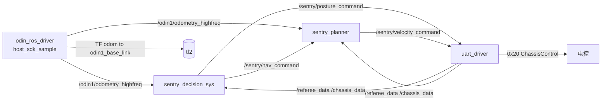

# SentryMaster 2026 —— 比赛理解 / 当前进度 / 任务清单

> 依据：`rulev1.3.pdf`（2026-10-11）、`README.md`（官方工作空间说明）、`1.md`（对 v1.2 的调研）、`QA`（**官方答疑，2026-10-15 新增**）、`txt`（第一轮预检录通知）、`src/**` 全部代码实测。
> 本文中带 `file:line` 的结论均为本次实测；推断项标 `[推断]`。

---

## 0. 速览

- **比赛本质**：5 分钟全自动的「时间窗 + 位置」得分赛。**没有射击、没有伤害、没有视觉对抗**——RM 强队哨兵的自瞄/装甲板/弹道学习在这里完全不需要。
- **算法只需三种能力**：① 稳定定位 + 点到点导航与驻留；② 任务调度（什么时候去哪、待多久、要不要转）；③ 姿态/能量管理与串口通信。
- **关键约束**：裁判系统只给 `game_time` 和 `sentry_posture`（`rm_msgs/msg/RefereeData.msg`），**没有得分、没有能量、没有位置遥测** → 决策必须是「自维护时间轴 + 用里程计自测位置」的开环调度器，永远无法从裁判数据确认「这分拿到没有」。
- **v1.4 改动（2026-10-16）**：① 单局平分判定从「**耗能多者胜**」改为「**获得最高得分耗时最短者胜**」→ 工程目标从「多耗能」变成**时间效率**；② 明确计时钟：比赛开始 `game_time=420`、每秒减 1、结束减到 `120`、裁判终止后归 `0`；③ 赛制细化为小组赛 BO2（同分比「两小局拿最高分耗时」）+ 淘汰赛 BO1；④ `QA2`：点位**自行标定**、**电控不做功率控制**（100 W 只能自己限速 + 实测）。详见 §1.2 / §1.3。
- **官方答疑已定调（`QA`）**：速度指令用**车体系**（vx = 底盘正前）、`wz` **逆时针为正**且就是**底盘自旋转速**（小陀螺与转向共用同一通道）；**场上只有一辆车**（无需对手避让）；补给区得分**每分钟必须先离开再进入**，但**离开距离阈值「后续见规则修改」** → 实现里必须做成可调参数。
- **当前进度**：代码是空壳。3 个 msg 缺失、uart 无发送链路、decision/planner 回调为空、`chassis.launch.py` 里 uart 与 odin 被注释掉、无任何 yaml 参数传递与打印 → **预检录第 3/4/5 项全部未达标，这是眼下最高优先级**。

---

## 1. 规则版本核对（v1.3 相对 v1.2 的实际差异）

逐行 diff `rulev1.2.pdf` 与 `rulev1.3.pdf` 提取文本，**只有 2 处差异**（363 行 vs 364 行）：

1. 修订日志表新增一行：`|2026.10.11|v1.3|修复关于评级的范围|`；
2. §8.1 措辞修正：`只有第一次检录会纳入评级` → `只有第一次预检录会纳入评级`。

**结论：v1.2 → v1.3 没有任何机制/得分/地图改动，`1.md` 中基于 v1.2 的全部分析对 v1.3 依然成立。** 唯一实际意义是：**评级只看第一次预检录**，预检录的完成度直接换算成每局初始分。

### 1.1.1 规则版本演进（v1.2 → v1.3 → v1.4）

| 版本 | 实质改动 |
|---|---|
| v1.3（10-11） | 只修 §8.1 措辞：评级只看**第一次预检录** |
| **v1.4（10-16）** | ① **单局平分判定变更**：原「消耗底盘能量多者获胜」→「**获得最高得分耗时最短的队伍获胜**」（第 2 条判定）；② **新增计时钟口径**：比赛开始 `game_time = 420`，每秒钟减少 1，比赛结束减到 `120`，裁判终止后归 `0`；③ **赛制细化**：小组赛抽签分 A/B 两组，每队一场 BO2，取「两小局累计分数最高」的前四进淘汰赛（同分取「两小局获得最高分数消耗的总时间，时间短的获胜」）；淘汰赛 BO1 逐组淘汰至冠军；④ 赛后措辞微调（断电后离开战场） |

**v1.4 的工程影响（重要）**：平分不再看耗能，看**谁更快把分拿到手** → 排程要「尽快把可得项做完」（减少无效等待、提高导航速度），**不要**再为了耗能刻意机动（P2.8 的旧思路作废，见 §2.4 与 P2.8）。

### 1.2 官方答疑第一轮（`QA`）结论及其影响

| 问 | 官方答复 | 对实现的影响 |
|---|---|---|
| Q1：`vx` 是否向前？`wz`/`yaw` 正方向？ | **`vx` 是底盘坐标系的正方向**；**`wz` 与 yaw 正方向为逆时针** | `VelocityCommand` 用**车体系**表达（前 = +x）；`wz` 逆时针为正 ⇒ 与 tf2 的 yaw 同号，§3 的 $v_{body}=R_z(-\psi)v_{world}$ 与朝向误差都**不需要改符号** |
| Q2：怎么把代码放到车载小电脑？ | **U 盘拷贝**，或 **git clone** | 赛前 checklist 必须包含「部署 + 依赖安装」步骤；源码/参数要能一条命令拿到（见 P6.2） |
| Q3：发给底盘的 `wz` 是小陀螺转速还是车头转向？场上几辆车？ | **`wz` 是底盘转速**；**一辆车** | ① 小陀螺与转向**共用同一个 `wz`**，两者不可能同时做 ⇒ 决策的 `spin_rate` 与导航的朝向闭环必须**显式仲裁**（见 P3.5）；② 导航**不需要对手避让**，只需不撞场地结构、不越界 |
| Q4(1)：提前做完所有得分项后去哪？要不要故意耗能？ | 「所有得分项目完成后请**自行按照规则要求扩大获胜面**」 | ~~旧解读：平分看耗能 → 末段多耗能~~。**v1.4 已把平分判定改成「获得最高得分耗时最短者胜」，该解读作废**：末段应继续刷 ①（先把总分做高，第一条判定优先）但**不为耗能而机动**；P2.8 已按此修正 |
| Q4(2)：① 能不能在 3:55 赖到 4:05 算两次？ | **不可以**一直在补给区/启动区里刷分，**每分钟都必须先离开再进入**才有该分钟的分数；**具体离开距离后续见规则修改** | ① 的「离开距离」阈值**会再改** ⇒ 必须做成 yaml 参数（当前取 6 m 余量），代码里别写死 5.0（见 P2.4） |

**第二轮答疑（2026-10-15，对应本文 P5-2/3/4/6）：**

| 问 | 官方答复 | 对实现的影响 |
|---|---|---|
| P5-2：`sentry_posture` 的 1/2/3 有何区别？占位字节会用吗？ | **1 和 2 都是得分姿态、没有区别**，**3 是移动姿态**；`ChassisControl` 的 5 个占位字节**将来也不会启用**；姿态切换冷却 **5 s** | `PostureCommand` 统一用 **1（得分）/ 3（移动）**；占位字节永远置 0，不预留逻辑；姿态时序按 5 s 冷却排（见 P2.5） |
| P5-3：`game_time` 单位 | **秒** | 时间轴按秒维护（`t = game_time`），无需换算 |
| P5-4：停留是否要求完全静止？ | **不要求完全静止** | 到位判据以「进入半径并保持」为主；速度≈0 只作为**自身**驻留稳健性判据，不是裁判要求 → 允许驻留期间做小幅位姿修正 |
| P5-6：得分效率适用范围 | **全部得分手段都乘倍数**（评级得分除外） | ②③④ 与 **⑤ 的 +20 都 ×1.5**；理论上限升到 **≈525 + 评级分**（见 §2.2） |

**净结论**：`1.md`/本文此前的关键假设（车体系速度、逆时针 wz、无对手、1/2 等价）与得分效率口径**全部被官方确认**；只剩两处需要工程对冲：① 补给区「离开距离」阈值（官方称后续见规则修改 → 参数化，默认 6 m 余量）；② ⑤ 的 ×1.5 与爬坡功率的矛盾（得分姿态只有 50 W，见 P2.5）。

### 1.3 官方答疑（`QA2`，2026-10-16）

| 问 | 官方答复 | 对实现的影响 |
|---|---|---|
| 具体坐标数据要训练那天才能拿到吗？ | **自行标定** | 点位没有任何官方数据 → `task_table.yaml` 用 NaN 占位 + 未配置阶段自动跳过（已实现）；必须在训练场自己量 odom 系坐标（`tools/view_map701.sh` 已能看 map.pcd，见 `3.md`） |
| 底盘电控有没有做功率控制？需要我们自己限速吗？有安全速度/小陀螺转速参考吗？ | **没有功率控制，功率问题自行测试解决** | 100 W（超限断电 20 s）**完全由算法侧兜住**：① planner 已加**加速度限幅** `max_acc_vx/vy/wz`（P3.4 提前落地）；② `max_vx/max_vy/max_wz` 与决策的 `spin_rate` 只是保守占位，**必须在真车实测功率后标定**；③ 新增 P7「真车标定」任务 |

---

## 2. 比赛要求与目标理解

### 2.1 平台与机制（rule §3、§5）

| 项 | 内容 |
|---|---|
| 形态 | 四舵轮哨兵，600×600×600 mm，官方提供车体与通信接口 |
| 运行方式 | 遥控器只用于切「自动模式」；比赛开始后全自动，不得人为干预 |
| 底盘功率上限 | 100 W，检录系统 10 Hz 结算，超限 → 底盘断电 20 s。**电控侧不做功率控制**（QA2）→ 100 W 完全由算法侧的速度/加速度/转速上限兜住，且这些上限必须**自行实测标定**（见 P7） |
| 能量 | 初始 20000，耗尽进入节能态（功率上限基础值降为 35 W，基本爬不动坡） |
| 姿态系统 | 开局默认移动姿态；切换冷却 5 s；**单一姿态一局累计超 3 分钟则效果降级**：移动姿态的功率倍率 1.5→1.2，得分姿态的得分效率倍率 1.5→1.2 |
| 得分效率 | 得分姿态的 ×1.5 与 §5.4 各得分手段（**除评级得分外**）是**乘积关系**；规则原示例：① 20×1.5 = 30 |
| 计时钟 `game_time` | **比赛开始 420，每秒减 1，比赛结束减到 120，裁判终止后归 0**（v1.4 §6.6）→ `t = game_time_at_start - game_time`（420→120 对应 t = 0→300 s）；`game_time == 0` = 未开始/已终止 → 待机 |
| 赛制（v1.4） | 小组赛：抽签分 A/B 两组，每队一场 **BO2**，取「两小局累计分数最高」的前四进淘汰赛（同分取**两小局拿最高分耗时的总时间**短者）；淘汰赛：**BO1** 逐组淘汰至冠军 |
| 周期 | 三分钟准备阶段 → 15 s 裁判自检 → 5 s 倒计时 → 5 分钟比赛 |

### 2.2 得分方式（rule §5.4）与上限估算

| # | 条件 | 基础分 | 时限 | 限制 | 备注 |
|---|---|---|---|---|---|
| ① | 回到补给区停留 5 s | 20 / 每分钟一次 | 全程 | **每分钟必须先离开补给区再回来**（v1.2 起；v1.2 阈值为 5 m，官方 QA 称「后续见规则修改」→ 实现参数化） | 得分姿态下停在补给区 5 s 同样计分 |
| ② | 经**起伏路段**上中央高地，在**正中**停留 20 s | 100 | 仅前 3 分钟 | 一局限一次 | 计入乘积（→150） |
| ③ | 经基地区斜坡上梯形高地，在**上方**停留 20 s | 50 | 仅前 3 分钟 | 一局限一次 | 计入乘积（→75） |
| ④ | 前**最后 2 分钟**到地堡（堡垒）停留 20 s 且**保持小陀螺** | 80 | 仅最后 2 分钟 | 一局限一次；**地堡有斜坡，必须稳定停在地堡中央，在斜坡上会清空计时**（v1.2 新增） | 计入乘积（→120） |
| ⑤ | 从补给区出发前往 ②③④ 途中**全程开底盘小陀螺**（转速需肉眼可见）直到到达停留点 | +20 | — | 过斜坡/起伏路段时可不开 | **已确认也 ×1.5 → 30**；但乘倍数要求全程得分姿态（50 W），与爬坡冲突，需实测取舍 |
| ⑥ | 预检录评级 A/B/C/D | +20 / 0 / −20 / −40 | — | 只算第一次预检录 | 明确不参与乘积 |

**基础分上限 ≈ 5×20 + 100 + 50 + 80 + 20 = 350**；官方已确认**所有得分手段（除评级）都乘得分姿态的 1.5**：① 5×30 = 150、② 150、③ 75、④ 120、⑤ 30 → **≈ 525 + 评级分**。这解释了为什么「按点拿分」比「跑得快」重要得多：漏一项就是 50~150 分，而得分姿态只在**停留期间**需要保持（规则原文：到点后保持即可）。

胜负判定顺序（v1.4）：① 得分高者胜 → ② 平分则**获得最高得分耗时最短的队伍获胜** → ③ 仍平则加赛。
**工程含义**：时间效率直接决定平局归属 → ① 先保证「分拿全」，② 再压缩「拿到这些分的时间」（更短路径/更高速度/更少等待；注意得分姿态功率减半会拖慢行进，所以只在停留时切得分姿态）。

### 2.3 场地结构（rule §4，v1.2 起以新版区域划分图为准）

基地区（启动区 / 补给区 / 堡垒=地堡）、高地区（梯形高地 200–400 mm、中央高地经坡道与公路区相连）、公路区（公路 / 飞坡 / 隧道 / **起伏路段**）。
→ 对算法的含义：**存在高度差与斜面**，需要「区域标记」（是否允许小陀螺、用哪种姿态、曲面/斜坡）与「斜坡上不驻留」。

### 2.4 由规则推出的关键工程结论

1. **没有遥测 → 开环调度**。得分判定完全靠「时间轴 + 自测位置 + 自测速度」；每项都要有超时降级与「保底回补给区」。真数据只有 `game_time` 和 `sentry_posture`。
2. **得分 = 停留 × 得分姿态（1.5 倍，覆盖全部得分手段）**。姿态切换有 5 s 冷却（已确认）、单一姿态累计 3 分钟上限 → 姿态按「到点前切得分、离点后切移动」编排；**爬坡/起伏路段绝不能在得分姿态**（功率只剩 50 W），因此 ⑤ 的 ×1.5 只在平路窗口可尝试。
3. **① 的「离开再进入」只能自测**。阈值做成参数（v1.2 为 5 m，官方称会再改；默认 6 m 留余量、别卡 5.0），并把补给任务拆成「拉出点 + 补给点」成对航点。
4. **④ 的「中央稳定停留 / 斜坡清零计时」把精度要求抬到最高**。停不稳 → 20 s 计时反复清零 → 这项永远拿不到。到位判据要更严（±0.15 m 级 + 速度≈0）。
5. **只有 5 个基础动作控制接口**：到点（x,y,yaw）、驻留保持、小陀螺旋转量、姿态切换、急停。
6. **v1.4 起「时间效率」是第二胜负手，且功率上限没人替你兜**：平分时比「拿到最高分用时」→ 排程与导航都要尽量快；同时电控不做功率控制（QA2）→ 速度/加速度/小陀螺转速上限必须自己限住并实测（超限会断电 20 s，直接白送时间）。
6. **地图/定位是最大风险**：地图与里程计的坐标系对齐关系必须先去训练场实测确认（见 §5 P5 待确认项 1）。

### 2.5 任务 → 控制接口 → 责任节点

| 比赛任务 | 基础控制接口 | 决策节点出什么 | 导航节点出什么 | 数据来源 |
|---|---|---|---|---|
| 到区域并停留 N 秒 | 目标点 + 驻留保持 | 指令：去哪、待多久、要不要转 | 速度 `vx,vy,wz` | 里程计 + `game_time` |
| ① 补给区「离开再进入」 | 拉出点航点 + 距离自测标志 | 判定「本分钟是否已离开 ≥ 阈值」 | 执行拉出点 | 里程计 |
| ⑦ 地堡中央稳定停留 | 更严的到位判据 + 驻留 | 到位/稳定判定 | 驻留精度控制 | 里程计 + 底盘速度 |
| 途中 / 停留小陀螺（⑤④） | 自旋角速度分量（与平移解耦） | `spin_rate` 标志 | 按标志叠加 `wz` | 里程计 yaw |
| 姿态切换（5 s 冷却、3 min 累计） | 姿态指令 | 按 `game_time` 决定 | — | `game_time` + 裁判回传姿态 |
| 能量管理（防节能态） | 无直接接口 | 任务节拍（别做无用机动） | 速度/加速度限幅 | 无遥测（开环） |
| 急停/异常（串口断、里程计丢、卡住） | 零速 + 安全姿态 | 超时降级 | 看门狗 | 话题时间戳 |

---

## 3. 目标数据流与接口契约



| 话题 | 类型 | 发布者 | 订阅者 | 单位约定 |
|---|---|---|---|---|
| `/referee_data` | `rm_msgs/RefereeData` | uart_driver | 决策、导航 | `game_time`（秒，**420→120 递减**，终止后 0，v1.4 §6.6）、`sentry_posture`(uint8) |
| `/chassis_data` | `rm_msgs/ChassisData` | uart_driver | 决策、导航 | vx,vy：**mm/s**；wz：**度/秒** |
| `/odin1/odometry_highfreq` | `nav_msgs/Odometry` | odin_ros_driver | 决策、导航 | 米/弧度，frame=`odom`，child=`odin1_base_link` |
| `/sentry/nav_command` | `rm_msgs/NavCommand` ✅ | 决策 | 导航 | 目标点 m、yaw rad（NaN=不约束）、spin deg/s、stay s、**`radius` 到位半径 m（NaN=用导航默认 0.15；导航侧 MODE_HOLD 另用更严的 `hold_radius`）** |
| `/sentry/velocity_command` | `rm_msgs/VelocityCommand` ✅ | 导航 | uart_driver | **与 `ChassisData` 一致：mm/s、度/秒（车体系，wz 逆时针为正）** |
| `/sentry/posture_command` | `rm_msgs/PostureCommand` ✅ | 决策 | uart_driver | **1 = 得分姿态（2 等价，代码统一用 1）、3 = 移动姿态** |

`ChassisControl` 的 5 个占位字节官方确认**永不启用**，固定置 0（不要为它们预留逻辑）。
不需要「导航 → 决策」反馈话题：决策自己订阅里程计即可判定到没到。
坐标系：里程计 frame=`odom`，URDF 给了 `odin1_base_link → vehicle` 的固连偏置（`xyz=-0.17893 0.16797 -0.00451, rpy=3.14159 0 -1.5708`，`sentry_chassis.xacro`）→ 目标点统一用 `odom` 系表达，用 tf2 查 `odom→vehicle`。

正方向约定（**QA 已确认**）：`vx/vy` 为**车体系**（`vx` = 底盘正前方），`wz` **逆时针为正**，且 `wz` 就是底盘自旋转速 —— 小陀螺与转向控制**共用一个通道**，同一时刻只能选一种模式：按 `spin_rate` 自旋，或做朝向闭环（$\omega_z = k_\psi \Delta\psi$）。

---

## 4. 当前进度（实测）

### 4.1 逐包状态

| 包 | 已有 | 缺（实测依据） |
|---|---|---|
| `rm_msgs` | `RefereeData`、`ChassisData`；**P0.1 已完成**：新增 `NavCommand` / `VelocityCommand` / `PostureCommand` 并已在 `rosidl_generate_interfaces` 注册 | — |
| `uart_driver` | 收串口 → 发 `/referee_data`、`/chassis_data`；**P0.4 + P1 全部完成**：订阅速度/姿态 → 50 Hz 组 `0x20` 帧发送（双看门狗）；接收侧校验帧长/帧头/id/帧尾/CRC16，失败即丢弃并计数；串口打不开不退出、后台 2 s 重连，`write` 与 `close/open` 共用端口互斥锁 | — |
| `sentry_decision_sys` | **P0.2 + P2 已完成**：`scheduler.py` 时间窗状态机（阶段序列 / ① 的分钟同步「离开再进入」/ 到位判据与停留计时清零 / 姿态编排含 5 s 冷却与 180 s 预算 / 小陀螺 / 末段刷 ① / 预计得分记账）；**`game_time` 按 v1.4 口径换算**（`t = 420 - game_time`，0 = 未开始/已终止 → 待机）；点位与阶段表放 `config/task_table.yaml`（**待打点**），引擎旋钮放 `config/decision.yaml`；10 Hz 发布 nav+posture（**nav 带每个点位的 `radius`**）、1 Hz 打印状态与 FSM 事件；**串口故障降级**（裁判或底盘数据中断 > `serial_fault_timeout` 2 s → 停车 + 强制移动姿态，恢复后自动接管）；README 已补（模块/时间轴/话题/兜底） | 现场点位实测（P3.2）与单局真实时序整定 |
| `sentry_planner` | **P0.3 + P3（航点图规划 + 纯跟踪 + 驻留）已完成**：装载离线栅格 `nav_map.bin`（占据/距离场/斜坡）与现场路径图 `waypoint_graph.yaml`（节点/边/禁转区）；`NavCommand` → **Dijkstra 规划**（逐边 `lineClear(0.35 m)` 校验，启动打印不可通行边与最差余量点；地图/路径图缺失时 `require_map` 拒绝运动）→ **纯跟踪**（前视 0.6 m、末段 √(2as) 梯形减速、`radius` 到位死区、HOLD 用 5 cm 死区小增益保持）→ 50 Hz 发布 `/sentry/velocity_command`；`max_acc_*` 变化率限幅（停车不受限）；决策指令/里程计/**底盘数据**三路看门狗 + 卡住检测；禁小陀螺区内强制忽略决策的 spin；参数来自 `config/global_planning.yaml`（真车标定 `config/speed_limits.yaml` 存在时自动叠加覆盖）并启动打印 | 真车速度/功率上限标定（P7）、现场路径图打点（P3.2/4.md） |
| `sentry_launch` | **P0.5 已完成**：`chassis.launch.py` 一键 include `odin1_ros2` + `driver` + `global_planning` + 决策包 `launch.py`，并用 `DeclareLaunchArgument` 暴露 4 个参数文件路径；package.xml 补齐 exec_depend | — |
| `odin_ros_driver` | 官方驱动，输出 `/odin1/odometry_highfreq` 等（`host_sdk_sample.h:1602`），三种模式 `custom_map_mode` 0 里程计 / 1 SLAM / 2 重定位 | **本方案用 mode 0（纯里程计）**（P3.1 决策）；漂移需真车实测（P7.0），不达标再评估 mode 2 |
| 地图 | `map.pcd`（二进制，299854 点）+ 500×500 二值 PNG | 与 odom 的对齐关系、PNG 的地理参考（原点/分辨率）、任务点坐标 |

### 4.2 已实测确认的事实与坑

1. **`chassis.launch.py` 注释掉 uart_driver 与 odin1**（`chassis.launch.py:72,74`）→ 一键启动时不会有裁判/底盘数据，也不会有串口发送。注释理由应是本机无硬件，但检录要求「一键启动比赛需要的节点」。
2. ~~CRC 失败会静默变成「全零假数据」~~ **已在 P1.1 修复**：原 `trans_uint8_struct` 在尺寸/CRC/头尾不符时 `memset` 后返回全零结构体，而 `handle_datas` 无条件发布 → 决策会收到 `game_time=0` 的假裁判包。现在改成 `parse_serial_struct()`（帧长+帧头+id+帧尾+CRC 全通过才解出结构体，失败返回 false），失败帧**丢弃并计数**（1 s 节流告警），旧函数已删除；载荷解析同时从「`data` 强转 `T*`」改为 `memcpy`（未对齐访问在 ARM 上是 UB）。实测见 §4.5。
3. **串口帧格式**：`0x7D | id | payload | CRC16(2) | 0x7E`；payload/CRC 中出现的 `0x7D/0x7E/0x7F` 转义为 `0x7F, (b-0x7D)`（`trans_struct_uint8` 发送侧转义、`read_from_port` 接收侧还原）。`ChassisControl` = 3×float + 5×uint8 = **17 B → 整帧 22 B**（3×float + `ph1` + `sentry_posture` + `ph2..ph4`）；`read_buffer_size: 60` 够用。
4. **vendored `serial` 库无内部锁 → 已加端口互斥（P1.3）**：发送定时器线程的 `write` 与读线程的 `close/open` 共用一把 `port_mutex`；`read` 只发生在读线程、`close/open` 也由读线程发起，所以 read 本身不需要持锁（否则读超时会阻塞 50 Hz 发送）。
5. **串口重连已改为非递归**（P0.4 顺带修掉）：`reopen_port()` 只做单次尝试，重试节奏由读线程控制（失败每 2 s 一次）；去掉了原先 `system("sudo chmod 666 ...")` 与无限递归，并让串口打开失败不再抛异常终止节点。
6. **`possible_ids: [17, 22]`**（`driver_config.yaml`）对应十进制 0x11 / 0x16，与 `serial_referee_id`/`serial_move_id` 一致 ✓。
7. **依赖现状**：`/opt/ros/kilted` 已装 `ompl`、`message_filters`、`pcl_conversions`、`tf2_eigen`；系统有 PCL 1.14 与 `fmt`（`/usr/lib/x86_64-linux-gnu/cmake/fmt`）。**`pcl_ros` 未安装**（kilted share 下不存在），但 `sentry_planner/package.xml` 依赖它（CMake 里没 `find_package(pcl_ros)`，所以当前能编译）——用 rosdep 会失败，别在这上面浪费时间。
8. **`sentry_planner/CMakeLists.txt` 用 `GLOB_RECURSE src/*.cpp`**：新增 cpp 自动纳入编译，不用改 CMake；`install(DIRECTORY config launch map ...)` 已就绪，yaml 直接放 `config/` 即可。
9. **`global_planning.yaml` 只有 `test_param: 1`**，且没有代码读取它 → 预检录第 5 项（yaml 参数传递 + 打印）现在必然不通过。
10. **`map.pcd` 实测包围盒**：x ∈ [1.445, 16.548]，y ∈ [1.065, 13.845]，z ∈ [0.1, 4.1]（z>0.5 的点约占 20%）。`map/701_model/info.md` 里的「X/Y ±25.0」**是转换前的场地坐标系**，而 `map.pcd` 本身已经落在 **Odin 起点系**（x/y 全为正）——见 `3.md` §0 的实测结论。PNG 是 500×500、mode `L`（二值），缺地理参考 → 打点时要与 PCD 一起标定。
11. **`sentry_decision_sys/package.xml` 已依赖 `python3-py-trees`**（行为树库），`setup.py` 里 `package_files('simulator')` 会去 walk 一个不存在的 `simulator/` 目录（当前无害）→ 官方暗示「行为树/仿真」都可选，但**5 分钟时间窗调度用 FSM 足够**，不必上行为树。
12. **本 checkout 未编译**（`build/`、`install/`、`log/` 均不存在，已被 `.gitignore` 忽略）。
13. **git 状态**：当前在 `main`，只有未跟踪的文档；`origin = QxhhhQ/SentryMaster2026`。README §5 硬性要求**先建开发分支再写代码**（main 要保持干净以接收官方补丁）。
14. **`.gitignore` 已把 `/*.md`、`/rule*.pdf`、`/.vscode` 忽略** ⇒ `1.md`/`2.md` **不会进入 git 提交**。若预检录/提交是走 git 仓库收内容，需要另行确认交付方式（U 盘、直接拷目录，或把文档移出仓库根目录）。
16. **50 Hz 错误刷屏已修**：串口未打开时发送定时器原本每 20 ms 打一行错误（实测 12 s 内 ~600 行），已改为 `RCLCPP_WARN_THROTTLE` 1 s 一条（实测 12 s 12 条）。
17. **`game_time` 口径已由 v1.4 明确**（§6.6）：比赛开始 420、每秒减 1、结束减到 120、裁判终止后归 0。→ 决策节点换算 `t = game_time_at_start - game_time`（默认 420），`t = 0` 对应比赛开始、`t = 300` 对应结束；**`game_time == 0` 表示未开始/已终止 → 待机零速**。注意这让「`game_time=0`」从「CRC 假数据特征」变成了**合法值**，所以 P1.1 的过滤只看帧结构/CRC、绝不能用 `game_time==0` 判伪。
18. **电控不做功率控制（QA2）**：100 W 上限（10 Hz 结算、超限断电 20 s）完全由算法侧承担 → planner 已加 `max_acc_vx/vy/wz` 变化率限幅（停车不受限，安全优先）；`max_vx/max_vy/max_wz` 与决策 `spin_rate`（默认从 360 降到 180 deg/s，规则只要求肉眼可见）都只是保守占位，**必须真车实测功率后标定**（P7）。
19. **点位的唯一来源是自行标定（QA2）**：官方不给坐标 → `task_table.yaml` 的 NaN 占位 + 未配置阶段跳过是必须的安全设计；`tools/view_map701.sh` + `3.md`（本仓库已有）可先把 `map.pcd` 显示出来辅助打点。
20. **本机 DDS 发现需要强制回环/SHM**（沙箱环境问题，非代码问题）：默认 `ROS_AUTOMATIC_DISCOVERY_RANGE=SUBNET` 下跨进程发现经常失败；FastDDS 的 UDP-only 回环 profile 起初可用、后来越来越差（python↔python 两进程 0 帧），**实测可用解法是两个进程都 `export FASTDDS_BUILTIN_TRANSPORTS=SHM`**（同机共享内存传输，python↔python 从 0 帧变 44 帧、planner↔工具链一次成功）。台架/仿真联调一律带上这个变量；真车单机多进程同样适用（同机 SHM 比 UDP 更稳更快）。见 §6 的排错说明。
21. **离线栅格已生成并可被 C++ 解析**：`map/701_model/nav_map.bin` = `NAVMAP1` 头 + 单行 JSON + `cost(u1)/dist(f4)/slope(u1)` 三段数组（行 0 = 最上面一行，origin 是左下**角点**，与 ROS `map_server` 一致）；实测 `323×276 @ 0.05 m`、占据 71%（含无点未知格 11834）、通行 29%、斜坡格 7653。同目录还输出 `nav_map.json/pgm/yaml` 供 RViz 显示。
22. **导航侧「没有地图就拒绝运动」是显式开关**：`require_map: true`（真车默认）时地图或路径图加载失败 → 打印 `[fault] ...` 并只发零速；台架/仿真用 `-p require_map:=false` 退化为直线跟踪。同理 `require_chassis_data: true`（无底盘反馈的台架用 `:=false`）。
23. **`map.pcd` 与本车 odom 的坐标系差异是现场必须补的一步**：`map.pcd` 在「官方录制起点系」，本车 odom 原点是「本次启动点」→ 现场用 `tools/calib_align.py` 标 3–4 个地标算 `map_alignment.yaml`（`p_odom = R(dyaw)·p_map + [dx,dy]`），再 `tools/build_nav_map.py`（会自动应用该对齐）把栅格重投影到 odom 系；RViz 叠加也走同一变换。
15. **官方答疑（`QA`）已关闭三个假设**：速度用**车体系**、`wz` **逆时针为正**、**单车上场无对手**（详见 §1.1）；新增待跟踪项：补给区「离开距离」阈值官方称「后续见规则修改」。

### 4.3 预检录 5 项对照（`txt` 的通知）

| # | 检查项 | 现状 |
|---|---|---|
| 1 | `scripts/build.sh` 编译通过 | ✅ 用户已确认（本 checkout 无 build 产物，需重新编译验证） |
| 2 | `scripts/chassis.sh` 一键启动 | ✅ 用户已确认 |
| 3 | 比赛节点间 **Topic 通信连接正常** | ✅ **已完成（P0）**：`/sentry/nav_command`、`/sentry/posture_command`、`/sentry/velocity_command` 均有真实收发，`/referee_data`、`/chassis_data` 有数据，见 §4.4 |
| 4 | **launch 脚本正常编写** | ✅ **已完成（P0.5）**：`chassis.launch.py` 一条命令起 odin1 + uart_driver + planner + decision（+ `robot_state_publisher`），参数文件路径可用 launch 参数覆盖 |
| 5 | **yaml 参数正常传递**（建议每个节点启动时打印参数） | ✅ **已完成（P0.6）**：三个节点各自 `config/*.yaml`，启动时全部打印 `[param] ...`（launch 实测输出见 §4.4） |

**注意**：评级只看第一次预检录，A/B/C/D 直接决定每局初始分 +20/0/−20/−40 → 第 3/4/5 项是眼下性价比最高的工作。

### 4.4 P0 完成后的验证记录（2026-10-15，无硬件，WSL2 本机）

验证方法：**假电控**（PTY 假串口 + 模拟底盘）+ **假底盘**（把收到的速度指令积分成里程计与 tf）搭闭环，串口侧走真实组帧（转义 + CRC16）。

| 验证项 | 操作 | 结果 |
|---|---|---|
| 编译 | `cd scripts && bash build.sh` | 6 个包全部编译通过 |
| 发送链路 + 组帧 | 假电控解析 `0x20` 帧 | 稳定 50 Hz 收帧、`crc_bad=0`；指令原值往返一致（`vx=321.0 vy=-222.0 wz=45.0 posture=2`） |
| 速度看门狗 | 停发速度指令 | ≤0.2 s 后速度字段归 0，不沿用旧指令 |
| 姿态看门狗 | 停发姿态指令 | ≤1 s 后姿态回到 `default_posture`（3 移动姿态） |
| 接收链路 | 假电控按帧发 `0x11/0x16` | `/referee_data` 211 帧（`game_time` 递增、`posture=3`）；`/chassis_data` 229 帧 |
| 决策发布 | 决策节点带 `decision.yaml` 运行 | `/sentry/nav_command` 121 帧（`mode=0 task=0 yaw=nan`）、`/sentry/posture_command` 120 帧（`posture=3`）；1 Hz `[status]` 日志正常 |
| 导航闭环 | 发 `NavCommand(GOTO x=3.0 y=1.0)` + 假底盘 | 指令先被限幅到 `max_vx=1000 mm/s`（实测 t=2 s: vx=1000.0 vy=490.9；t=4 s: vx=491.3 vy=23.4），最终收敛到 **x=2.852 y=0.993**（距目标 0.148 m ≤ `arrive_radius=0.15`）后归零 |
| 卡住检测 | 底盘反馈恒 0 而指令 1003 mm/s | 打印 `robot may be stuck: command 1003.1 mm/s but chassis feedback 0.0 mm/s for 2.0 s` |
| 一键 launch | `ros2 launch sentry_launch chassis.launch.py` | odin1 + uart_driver + planner + decision 全部起来并打印各自 `[param]`；无串口时 uart 后台重连、决策 1 Hz 状态日志与 tf 缺失告警均正常，无节点崩溃 |

**结论**：`决策 → 导航 → uart_driver → 串口(0x20)` 与 `串口(0x11/0x16) → uart_driver → 决策/导航` 两条链路都有可复现证据，预检录第 3/4/5 项达标。

### 4.5 P1 完成后的验证记录（2026-10-16，无硬件）

| 验证项 | 操作 | 结果 |
|---|---|---|
| 无效帧过滤 | 假电控每 5 帧注入 1 个「载荷被篡改、CRC 失效」的裁判帧（载荷内 `game_time=0`） | `/referee_data` 收 257 帧、**`game_time==0` 帧数 = 0**（修复前同口径 52 帧），出现的 posture 只有 `{3}`；驱动日志每 1 s 一条 `invalid referee frame dropped (size=30, dropped=N)`，计数单调递增 |
| 好帧不受影响 | 同上 | 好帧仍按 4/5 比例正常发布（≈16 Hz，对应 20 Hz 发送 + 1/5 注入），`game_time` 递增正常 |
| 设备拔插/重启恢复 | 杀掉假电控（关闭 pty）→ 等 5 s → 重启 | 断开期间只有 1 s 节流的 `serial port is null, skip`，**无异常逃逸、无崩溃**；`Error creating serial port ... No such file` 每 2 s 重试；设备回来后 `Successfully reopened /tmp/tty_fake_ecu`，0x20 帧立刻恢复 50 Hz（11 s 内 506 帧） |
| 指令往返（新写锁路径） | 注入 `vx=321 vy=-222 wz=45 posture=2` | 串口侧原值一致；停发后 ≤0.2 s 速度归零、≤1 s 姿态回 3 |
| 编译 | `cd scripts && bash build.sh` | 6 包通过 |

补充观察：这套 `0x7D/0x7E` 帧格式下，若**转义字节本身**被破坏，接收侧会提前切断该帧并需要重新同步（顺带丢掉紧随其后的少量好帧）。真实电控发送的都是合法帧，不会触发；注入测试里表现为丢弃计数偶尔跳变，属预期行为。

> 踩坑记录（不影响仓库）：`scripts/build.sh` 内部会 `cd ..`，必须**在 `scripts/` 目录里执行**；从工作空间根目录执行 `bash scripts/build.sh` 会把 `build/install/log` 建到**上级目录**（我踩过一次，已清理）。此外 `--symlink-install` 下 `install/` 里是符号链接，看产物时间戳会看到链接本身的旧时间，判断是否重编要看 `build/` 下的 `.o`。

### 4.6 P2 完成后的验证记录（2026-10-16，无硬件）

**A. 调度逻辑仿真**（纯 python，虚拟时钟跑满整局，`/tmp/sim_schedule.py` + 填测试坐标的任务表）：

| 检查项 | 结果 |
|---|---|
| 阶段顺序 | `supply_m1 → central_high → supply_m2 → trapezoid_high → supply_m3 → supply_m4 → bunker → supply_m5 → expand_margin…` 全部按时间窗进入，无跳阶段、无提前放弃 |
| ① 的分钟同步 | 每个 ① 阶段都在拉出点等到整分钟窗口（`WAIT`）再进补给区，停留 5 s 后判定「①有效：最远离补给点 11.3~12.7 m ≥ 6 m」 |
| ②③④ | 中央高地 / 梯形高地 / 地堡各在半径内停留 20 s（HOLD 期间距离 0.00），分别 +150 / +75 / +120 |
| ⑤ 小陀螺 | 往返 ②③④ 的三段行程 `spin` 标志为真，各 +30（按「每趟一次」实现，规则表述含糊，见 §2.2 备注） |
| 姿态编排 | 行进=3（移动）、距目标 0.6 m 内切 1（得分）、离点切回；日志可见相邻切换间隔 ≥5 s（冷却生效）；得分姿态累计 149 s、移动姿态 190 s，超 180 s 时打出降级告警 |
| 预计得分 | 比赛内 **585**（①×5=150 + ②150 + ③75 + ④120 + ⑤×3=90）；超时进入末段循环后再刷一次 ① → 615 |
| 末段策略 | 阶段表跑完后进入 `expand_margin`：拉出点等分钟 → 进补给区停留 5 s 刷 ①，全程移动姿态（功率 ×1.5） |

**B. 决策节点 + 真实数据链路**（真串口帧、裁判 `game_time` 1 s 递增、真实 tf 位姿）。注：这一轮的假电控还用「1 s 递增」的简化口径；v1.4 明确 420→120 递减后，假电控与验证脚本已同步改成官方口径（见 §4.7）：

| 检查项 | 结果 |
|---|---|
| 任务表加载 | `[task_table] points=5 已配置=['supply','supply_pullout','central_high','trapezoid_high','bunker'] 待打点=无 phases=7` |
| game_time 方向判定 | `game_time=5→169(up=True)`：相邻帧增量 >0 自动判定为「已进行」并入 `t` |
| 阶段推进 | 与仿真一致：7 个阶段 + `expand_margin` 依次进入，日志 `enter/abort/姿态切换` 齐全；未运动时各阶段按 `t_end` 超时放弃（降级路径生效） |
| 姿态指令 | 随阶段在 1/3 之间切换（`[fsm] 姿态切换 -> 1/3`），切换间隔 ≥5 s |

**C. 运动链（决策 → 导航 → 串口 → 底盘）**：见 §4.4 —— `NavCommand(GOTO 3.0,1.0)` 经导航 → `0x20` 帧 → 假底盘后收敛到 0.15 m 内、停发后双看门狗归零。

> 本机 WSL2 的 DDS 发现在「5 个进程同时在线」时按进程对随机失败（每对约一半概率），所以「决策节点亲自驱动整车跑完一局」的一次性联调没能在本机完成，需要在训练场/真机做（P4.3）；因此 P2 的验证拆成上面三段独立证据 + 纯逻辑整局仿真。

### 4.7 v1.4 / QA2 改动后的验证记录（2026-10-16）

| 验证项 | 操作 | 结果 |
|---|---|---|
| **`game_time` 换算**（v1.4 §6.6） | 直接把 `RefereeData` 喂给**真实节点类**（不开 DDS，避免被环境抖动掩盖） | `420→t=0.0`、`415→t=5.0`、`300→t=120.0`、`120→t=300.0`、**`0→None`（待机）**；方向自动判定 `counting_up=False`；待机决策 `mode=0`（零速）。**首跑暴露一个边界 bug：第一条裁判帧时方向未知 → 返回 `t=420`；已修**（方向未判定时按官方区间 120~420 判定口径），复跑全绿 |
| **无效帧过滤**（P1.1 回归） | 假电控每 5 帧注入「载荷篡改 + CRC 失效」裁判帧（载荷标记 `game_time=4242`） | 驱动 `invalid referee frame dropped` 计数稳定增长（≈4/s，等于注入率），`crc_bad=0`（转义/CRC 解析正常）；决策侧从未出现 4242 这个标记值 |
| **加速度限幅**（QA2 新增） | 导航 + 假底盘 + 注入 `NavCommand(GOTO 3,1, spin=180)`；为便于观察把 `max_acc_*` 临时改小到 200 mm/s²、72 deg/s² | 指令**斜坡上升**：`96.1 → 204.1 → 304.0 → 1000` mm/s（≈200 mm/s²，与配置一致）与 `34.6 → 73.5 → 109.4 → 180` deg/s（≈72 deg/s²）；到达 `max_vx/max_wz` 后饱和；**停车路径不受限**（立即归零，安全优先） |
| 编译 | `cd scripts && bash build.sh` | 6 包通过 |

### 4.8 P3（导航）实现与验证记录（2026-10-16，无硬件）

**A. 地图 → 栅格（离线，真 `map.pcd`）**：`tools/build_nav_map.py` 生成 `map/701_model/nav_map.{bin,json,pgm,yaml}`：
栅格 `323×276 @ 0.05 m`、原点（左下角）`(0.90, 0.55)`、占据 63262（含无点未知格 11834）、通行 25886、斜坡/台阶格 7653、
`dist` 用 scipy 精确距离变换（最大 2.05 m）；回读校验 `bin 逐格一致=True / pgm 占据逐格一致=True`；ASCII 渲染可肉眼看到墙体与高地结构。
导航 C++ 侧能直接解析该文件：`[map] loaded .../nav_map.bin grid 323 x 276 @ 0.05 m source: src/.../map.pcd`。

**B. 规划 + 纯跟踪（合成「带墙地图」闭环，规模可判真假）**：6×6 m 栅格 + 一堵墙（x 2.9–3.1、y<4.5）+ U 形路径图（n1(1,1)→n2(1,5.2)→n3(5,5.2)→n4(5,1)），命令 `(0,0) → (5,1)`（直连 5.1 m 会穿墙，必须绕到 y>4.5 的通道）：

| 检查项 | 结果 |
|---|---|
| 启动自检 | `[graph] loaded ... nodes 4 edges 3 禁转区 1 不可通行边 0`；路径图为空模板（真车未打点）时 `[fault] 地图/路径图不可用 ... require_map=true -> 拒绝运动`（**设计行为**，不是 bug） |
| 规划 | `[plan] 6 个点 13.81m：n1 ... n4`（= 起点段 + 4.2 + 4.0 + 4.2 + 终点段，符合 U 形路线） |
| 纯跟踪 | `[nav] cmd` 序列 `(40,40) → (33,600) → (0,600) → (600,139) → (600,1) → (178,-600) → (2,-600) → (0,-367) → (0,0)`：先斜插到左走廊、沿走廊上行、越过墙顶通道、沿右侧下行 |
| 到位 | 终态 `(5.00, 1.15)`，`d=0.15 = r` → `cmd=(0,0,0)`；仿真轨迹 x 0..5.00、y 0..5.20，**全程没有在 y<4.5 处穿过墙体** |
| 效率 | 13.81 m 路径在 `max_vx=600 mm/s` 下约 26 s 跑完（末段 √(2as) 减速生效，最后 1 m 由 367→0） |

**C. 驻留精度与小陀螺仲裁（P3.5/P3.6，同套仿真）**：

| 检查项 | 结果 |
|---|---|
| 禁小陀螺区抑制 | 车在区内、决策要求 180 deg/s → `[spin] 当前位于禁小陀螺区 start_zone，忽略决策的 180 deg/s（避免斜坡上超功率）`，实测 `wz=0` |
| 出区后小陀螺生效 | 离开该区后 `wz=180` |
| `MODE_HOLD` 驻留 | `r=0.05`（`hold_radius`）→ `d` 收敛到 0.05 后稳定，**平移指令归零、只保留 `wz=180`**（正是地堡「停留 + 小陀螺」工况），无来回抖动 |

**D. 故障降级（P3.7，直接给真实决策节点喂数据）**：

| 检查项 | 结果 |
|---|---|
| 串口长时间无数据 | `_serial_fault()=True` → 发布 `NavCommand(mode=0, radius=NaN)` + `PostureCommand(3)`，日志 `串口数据中断 > 2.0s：停车 + 回移动姿态` |
| 数据恢复 | `_serial_fault()=False` → 回到正常调度路径（`t=0.0`） |
| 数据再次变旧 | 重新判故障 ✓ |
| 导航侧看门狗 | 决策指令超时 1.0 s / 里程计超时 0.5 s / **底盘数据超时 0.5 s（本轮新增）** → 零速；驱动侧 `velocity_timeout=0.2 s` 兜底（P1.2） |

**E. 现场工具链（`tools/`）验证**：

| 工具 | 验证方式 | 结果 |
|---|---|---|
| `build_nav_map.py` | 真 `map.pcd` 生成 + 回读逐格比对 + ASCII 渲染 | 见 A（bin/pgm 逐格一致、几何一致） |
| `mark_points.py` | `--no-ros --script` 脚本化打点 + `/clicked_point` 实链路 | 5 点写回后**非点位行字节不变**（diff 仅那 5 行）、`.bak` 与原文件一致、二次运行结果一致、supply↔pullout <6 m 警告触发；`save` 后地图自检（用真 `nav_map.bin`，323×276@0.05）逐点打印 free/occ/越界与安全边距，<0.35 m 显式告警 |
| `calib_align.py` | `--self-test` 合成数据 | 全过（变换恢复误差 ≤3e-15 m/deg 对 1e-9 上限）；逐地标残差 >0.15 m 单独提示、n<3 或 RMS>0.30 拒绝写文件 |
| `dry_run_nav.py` | 真 planner + `--simulate` + 合成带墙地图（`require_map=true`） | 3 段 **PASS 3 / FAIL 0**、退出码 0、总耗时 9.93 s；导航日志 `[nav] ... r=0.20` 证明 `NavCommand.radius` 端到端生效；超时/点名不存在两条失败路径均 FAIL + 退出码 1 |
| `calib_speed.py` | `--dry-run`/`--script` 分级表 + schema + launch 读取 | 13 级分级表正确；写入 `<share>/config/speed_limits.yaml` 后被 launch 自动叠加（实测 `max_vx=800` 覆盖了 `1000`） |

**F. 本轮踩到并修掉的坑（导航侧）**：① 地图 JSON 头解析对「逗号后有空格」过敏，导致 `dist` 被**静默补零** → 所有路径判为不可通行；现改为严格校验（缺数组直接报错退出）并把「最差余量点坐标」打出来便于现场定位；② 末段减速公式单位错（m 混 mm），实测全程被限速到 ~140 mm/s；改为 mm 换算后实测 600 mm/s。

**G. 环境结论（台架/仿真必看）**：本机跨进程 ROS2 发现已基本不可用，**必须两个进程都 `export FASTDDS_BUILTIN_TRANSPORTS=SHM`**（旧 UDP 回环 profile 已失效）——见 §4.2 第 20 条。

> 本机 WSL2 的 DDS 发现问题同样影响导航联调（每组进程对约一半概率失败），以上结果均来自「重试到链路打通」的那一次，日志与数值都是实测。

---

## 5. 接下来的任务清单

### P0 —— 预检录 3/4/5 项（最先做，直接换初始分）

- [x] **P0.1 打通 3 个新 msg**：在 `rm_msgs/msg/` 新增 `NavCommand.msg` / `VelocityCommand.msg` / `PostureCommand.msg`（字段建议见 §3 表；单位必须与 `ChassisData` 一致：mm/s、度/秒），并在 `rm_msgs/CMakeLists.txt` 的 `rosidl_generate_interfaces` 中注册。
  - 验收：`ros2 interface show rm_msgs/msg/NavCommand` 正常输出。
- [x] **P0.2 决策节点加 publisher + 参数化**：新增 `/sentry/nav_command`、`/sentry/posture_command` 两个 publisher，加 `create_wall_timer` 周期任务，`declare_parameter` 读取路径点表 yaml，**启动时用 `self.get_logger().info()` 打印全部参数**。
- [x] **P0.3 导航节点加 publisher + 参数化**：新增 `/sentry/velocity_command` publisher、`declare_parameter`（话题名/限幅/到位半径/控制周期），启动打印参数。
- [x] **P0.4 uart_driver 接上发送链路**：`transfer` 加两个订阅者（velocity/posture）存最新值+时间戳+mutex；新增公有 `send_chassis_control()`（按 `struct_def.hpp` 示例填充 `vx,vy,wz,sentry_posture`）；节点里 `create_wall_timer` 周期发送（周期放 yaml，建议 50–100 Hz）。
  - 验收：假串口（见 §6）上能看到 **22 字节** `0x20` 帧（2 头 + 17 载荷 + 2 CRC + 1 尾），CRC 正确、转义正确 —— **已实测通过，见 §4.4**。
- [x] **P0.5 重写 `chassis.launch.py`**：取消注释 uart_driver / odin1；decision 改为 include 该包自己的 `launch/launch.py`（或至少带 parameters）；每个节点显式传自己 `config/*.yaml` 的绝对路径（用 `PathJoinSubstitution(FindPackageShare(...))`，不要硬编码 `/home/...`）。
  - 验收：`ros2 launch sentry_launch chassis.launch.py` 一条命令起全部比赛节点（odin1 驱动 + uart_driver + planner + decision + `robot_state_publisher`）—— **已实测通过，见 §4.4**。
- [x] **P0.6 每个节点 yaml 加参数并打印**（含 uart_driver 的串口参数、planner 的限幅/到位半径、decision 的路径点表与时间窗），并**给 launch 加 `DeclareLaunchArgument`** 允许覆盖。
  - 验收：启动日志里能看到每个节点打印的参数值（预检录原文明确建议这么做）。

> P0 全部完成并通过实测验证（§4.4）；下一步按顺序进入 P1/P2。

### P1 —— 通信可靠性（决定比赛能不能跑完 5 分钟）✅ 全部完成（证据见 §4.5）

- [x] **P1.1 丢弃无效裁判/底盘包**：新增 `parse_serial_struct()`（帧长 + 帧头 + id + 帧尾 + CRC16 全部通过才输出结构体），`handle_datas` 对失败帧**丢弃并计数**（1 s 节流告警带累计数）；删除了「校验失败返回全零结构体」的 `trans_uint8_struct`；载荷改用 `memcpy` 解出（避免 ARM 上未对齐访问 UB）。
- [x] **P1.2 速度/姿态看门狗**（随 P0.4 落地）：速度超时（0.2 s）发零速、姿态超时（1.0 s）回移动姿态 —— 已实测。
- [x] **P1.3 并发与重连加固**：`write` 与 `close/open` 共用 `port_mutex`（`read` 只在读线程内，无需持锁）；统一走 `close_serial()`；`reopen_port()` 单次尝试 + 读线程 2 s 重试；去掉 `system("sudo chmod 666 …")` 与无限递归；串口打不开不再终止节点 —— 拔插/重启设备实测自动恢复。
  - 关于「重连期间发零速」：端口不存在时物理上发不出去，此时按**不发送**处理，安全交给电控侧看门狗；重连成功后立刻恢复 50 Hz 发送（已实测）。

### P2 —— 决策：时间窗调度器（FSM 足够）✅ 已完成（证据见 §4.6）

- [x] **P2.1 时间基准**：**v1.4 已给出确切口径**（420 → 120 递减、终止后 0）→ `t = game_time_at_start - game_time`（参数 `game_time_at_start/at_end`，默认 420/120），`game_time == 0` = 未开始/已终止 → **待机**；同时保留方向自动判定（相邻帧增量 >0 判「已进行」、<0 判「剩余」，|增量|>100 视为回绕忽略）作为兜底；裁判帧超时 0.5 s 或位姿超时 0.5 s → 待机零速。
- [x] **P2.2 任务点表 yaml**：`config/task_table.yaml` 的 `points`（supply / supply_pullout / central_high / trapezoid_high / bunker，各带 x,y,yaw_deg,radius）。**坐标先 NaN 占位，未打点的阶段自动跳过并告警**（不会把车开去 (0,0)）；拉出距离由 `leave_supply_dist`（默认 6 m 余量）核对。禁小陀螺区/斜坡区属导航侧区域处理（P3）。
- [x] **P2.3 调度骨架**（已落成 `task_table.yaml` 的 `phases` 表；下表为参考解，顺序与时间窗按实地实测调整）：

  | 时间 | 动作 | 姿态 | 小陀螺 |
  |---|---|---|---|
  | 0:00–0:50 | 前往补给区（第 1 分钟窗口） | 移动 | 关 |
  | ~0:50 | 补给区停留 5 s → ① | 到达后切得分 → 停完切回 | — |
  | 1:00–1:40 | 经起伏路段上中央高地正中 | 移动（坡度段禁用得分姿态） | 开（起伏路段关） |
  | ~1:40 | 停留 20 s → ② （100 → 150，乘积关系） | 停前切得分 | — |
  | 1:40–2:05 | 回补给区（第 2 分钟窗口，经拉出点） | 移动 | 开 |
  | 2:05–2:35 | 经基地区斜坡上梯形高地，停留 20 s → ③ | 移动→得分 | 开（斜坡关） |
  | 2:35–3:00 | 回补给区（第 3 分钟窗口） | 移动 | 开 |
  | 3:00–4:00 | 第 4 分钟补给区窗口 + 机动至地堡附近待命 | 移动 | 按 ⑤ 规则 |
  | 4:00–4:40 | 地堡**中央**停留 20 s + 小陀螺 → ④ | 得分 | 开 |
  | 余下 | 第 5 分钟补给区窗口 | 移动 | 关 |

- [x] **P2.4 ① 的「离开再进入」判定**：用 tf 位姿实时统计「本窗口内离补给点的最远距离」，停留完成时与 `leave_supply_dist` 比对，未达标则本次不计分并打日志；① 阶段用 `pre_wait_minute` 在拉出点**等整分钟窗口**再进入，保证 5 s 停留落在该分钟内（实测见 §4.6）。
- [x] **P2.5 姿态编排**：行进用移动姿态，距目标 < `posture_switch_dist` 时切得分姿态、离点后切回；遵守 **5 s 冷却**（未到冷却则维持原姿态）；统计各姿态累计时间，超 180 s 打降级告警。**⑤ 的 ×1.5 需全程得分姿态（50 W）**，与爬坡冲突 → 参考解只在平路窗口吃倍率，实测后再定策略。
- [x] **P2.6 到达/驻留自判定与超时降级**：判据＝距离 < 半径并连续保持 `arrival_hold_sec`（0.3 s）；**不要求完全静止**；停留期间被推出 `radius×stay_reset_factor` 则停留计时清零（对应地堡斜坡清空计时）；阶段超过 `t_end` 即放弃（不记分）并跳到下一个未过期阶段。
- [x] **P2.7 状态日志**：1 Hz 打印 `[status]`（t/位姿/速度/game_time 方向/裁判回传姿态/当前阶段/子状态/姿态/停留进度/预计得分/各得分项次数/姿态累计），阶段切换、到位、停留清零、得分、姿态切换等事件用 `[fsm]` 逐条打出。
- [x] **P2.8 末段策略（已按 v1.4 修正）**：阶段表跑完后进入 `expand_margin` 循环——在拉出点等整分钟 → 进补给区停留 5 s 继续刷 ①（**先比总分**，第一条判定优先），但**不再为了耗能刻意机动**：v1.4 把平分判定改成「获得最高得分耗时最短者胜」，所以末段目标是**尽快把分拿完**（等待整分钟是规则要求；移动姿态是为了 ×1.5 功率、跑得更快）。开关 `expand_enabled`。

### P3 —— 导航（`sentry_planner`）✅ 已完成（代码 + 仿真证据见 §4.8；真车标定见 P7 / 4.md）

- [x] **P3.1 定位方案定型**：**选定「纯里程计（`custom_map_mode=0`）+ 现场打点」**（用户决策：先落地，训练场实测 5 min 漂移不达标再考虑 mode 2 重定位）。零重定位风险、不依赖官方地图格式；代价是漂移必须实测（P7.0）。官方 `map.pcd` 降级为**参考底图**：离线转成占据栅格（`tools/build_nav_map.py`），现场用 `map_alignment.yaml`（map→odom 二维刚体变换）重投影到本车坐标系做 RViz 叠加与点位校验；规划/控制全在 odom 系。
- [x] **P3.2 打点工具**：`tools/mark_points.py`（**两种输入都支持**：键盘 TUI 记录车体 tf 位姿 + RViz `Publish Point` 点选，`--source pose|click|either`）。命令 `next/set/yaw/radius/node/link/zone/del/undo/save`；`save` 只改 `task_table.yaml` 的点位 5 行（逐行替换、保留注释、先存 `.bak`）并整份写 `waypoint_graph.yaml`；写前跑**地图自检**（每个点在栅格里的安全边距，<`path_margin` 或落占据格/越界就显式告警）；`--no-ros --script` 可离线回归；supply↔pullout 距离 < 6 m 会警告。地图对齐用 `tools/calib_align.py`（地标配对 + Umeyama 二维刚体解算，逐地标残差 >0.15 m 单独提示，n<3 或 RMS>0.30 m 拒绝写文件，`--self-test` 用合成数据验证恢复精度）。
- [x] **P3.3 全局规划**：**航点图 + Dijkstra**（用户选定方案）。离线 `tools/build_nav_map.py`：`map.pcd` → 5 cm 栅格（占据/斜坡两图 + `dist` 精确距离场 + PGM/YAML 给 RViz）；现场 `mark_points.py` 标节点与连边 → `config/waypoint_graph.yaml`；导航侧 `nav_map.cpp`/`waypoint_graph.cpp`：逐边 `lineClear(path_margin=0.35 m)` 校验（启动打印不可通行边数 + **最差余量点坐标**）、Dijkstra 求最短路、路径 = 车 → 最近节点 → 节点序列 → 接入节点 → 目标（两段直连同样校验）；**无解即停车**（`require_map` 下地图/路径图缺失同样拒绝运动），绝不盲走。
- [x] **P3.4 轨迹跟踪**：**纯跟踪（Pure Pursuit）**：路径折线投影 → 前视 `lookahead_dist=0.6 m` → 世界系速度 → 车体系输出 + 限幅；**末段梯形减速** `v ≤ √(2·a·s)`；到位用 `NavCommand.radius`（决策按点位下发，NaN 用 `arrive_radius=0.15`）；`max_acc_vx/vy/wz` 变化率限幅（停车不受限）。真车速度/加速度上限仍待 P7 标定。
- [x] **P3.5 小陀螺 / 朝向仲裁**：`spin_rate != 0` → `wz = spin_rate`（放弃朝向闭环），否则 `wz = clamp(k_ψ·Δψ)`（保留原实现）；**新增禁小陀螺区**：车体落在 `waypoint_graph.yaml` 的 `spin_forbidden_zones`（现场标的斜坡/起伏段）内时**强制忽略决策下发的 spin** 并告警 —— 这是 100 W 上限下唯一能自动兜住「斜坡上自旋超功率」的机制；仲裁切换由 `max_acc_wz` 平滑（不会瞬跳）。
- [x] **P3.6 驻留精度**：`MODE_HOLD` = 位置保持 + `hold_radius=0.05 m` 死区 + 小增益 `hold_gain=0.8` + 修正速度上限 `max_hold_speed=200 mm/s`（地堡/斜坡上只做小幅修正，避免蹭上斜坡）；实测 d→0.05 后平移归零且无抖动，小陀螺同时保持（见 §4.8C）。
- [x] **P3.7 看门狗与故障联动**：导航侧四路（决策指令 1.0 s / 里程计 0.5 s / **底盘数据 0.5 s（新增）** / 地图缺失）→ 零速；决策侧 `serial_fault_timeout=2.0 s`（裁判或底盘中断）→ 停车 + 强制移动姿态，恢复后自动接管（实测见 §4.8D）；驱动侧 `velocity_timeout=0.2 s` 发零速兜底。

### P4 —— 无硬件验证（强烈建议，先做）

- [ ] **P4.1 假电控**：`socat -d -d pty,raw,echo=0,link=/tmp/ttyA pty,raw,echo=0,link=/tmp/ttyB` 造串口对，用 Python 按帧格式发 `0x11/0x16` 包、解析 `0x20` 包并打印 `vx,vy,wz,posture` → **无车验通 uart_driver 全链路（转义/CRC/看门狗）**。
- [ ] **P4.1b 与电控对表**：用假电控/真车确认 `vx` 为车体正前、`wz` 逆时针为正（QA Q1 的口径与电控实现一致），并把发送频率对齐电控侧看门狗（P5 第 5 条）。
- [ ] **P4.2 假底盘**：写一个节点把 `VelocityCommand` 积分成 `/odin1/odometry_highfreq` + tf → 无车跑通「决策+导航」闭环，并能脚本回放整局 5 分钟，检查调度时序与预计得分。
- [ ] **P4.3 真车/训练场**（两次 15 分钟）：`ros2 bag record -a` 全程录包、`ros2 run tf2_tools view_frames`、放车看 `map.pcd` 与 odom 是否对齐。

### P5 —— 待确认（走 rule §1.2 飞书答疑 + 电控同学，尽快）

**已由答疑关闭**：~~速度是否车体系~~、~~wz/yaw 正方向~~、~~小陀螺与转向是否同通道~~、~~场上是否多车~~、~~能否赖在补给区刷分~~、~~1/2 是否等价~~、~~占位字节是否启用~~、~~game_time 单位/方向/范围~~（v1.4：420→120→0）、~~是否要求完全静止~~、~~得分效率适用范围~~、~~点位从哪来~~（QA2：自行标定）、~~电控是否做功率控制~~（QA2：不做，自己限）。见 §1.1~§1.3。

仍待确认：

1. **`custom_map_mode` 用哪种？** —— **已决策：先用 mode 0（纯里程计）+ 现场打点**（§P3.1）；仍建议问官方两点：① 是否提供设备格式（`.bin`）地图用于 mode 2 重定位（有没有别的队已经拿到）；② 若将来转 mode 2，建图与重定位是否必须在同一台 odin 上完成（README 说「建议起点距建图起点 1 m/10° 内」）。纯里程计路线下唯一的自测项是 **5 min 漂移量**（写进 P7.0）。
2. 姿态回传细节：切换生效时机、裁判回传是否即时（取值本身已确认）。
3. 准备阶段的 `game_time` 是否就是 0（若是，决策待机即可；若准备阶段已是 420，需要另加启动判据）。
4. 驻留期间位姿修正的幅度上限（「不要求完全静止」已确认）；地堡「中央」的具体范围。
5. 串口期望：`ChassisControl` 期望发送频率、电控侧看门狗超时时间（当前 50 Hz / 0.2 s）。
6. 补给区「离开距离」的具体数值与判定口径（已确认必须离开再进入；**阈值官方称后续见规则修改** → 参数默认 6 m 余量）。
7. 地堡「斜坡清空计时」的判据（位置？倾角？）→ 决定 P3.6 的驻留策略。
8. **功率怎么自测**：是否提供功率计/裁判系统功率读数？超限断电 20 s 后是自动恢复还是要重新上电？（QA2 把「功率问题」推给我们，但没说测量手段）
9. 预检录评级的 A/B/C/D 具体判定标准（完成度口径）。
10. **提交/收集方式**：`.gitignore` 忽略 `/*.md`，`1.md`/`2.md`/`3.md` 不进 git —— 预检录是收 git 仓库还是整目录？

### P7 —— 真车标定与安全（QA2 驱动：电控不做功率控制）

- [ ] **P7.0 里程计漂移实测（纯里程计路线的前提）**：真车静止放置 5 分钟看 odom 零漂；再沿场地绕一圈（回到同一物理点），记录 odom 位置/航向偏差。判定：**平移 ≤ 0.3 m 且航向 ≤ 3°** 才继续纯里程计路线；不达标就评估 `custom_map_mode=2` 重定位（要额外上场地建图）。用 `ros2 bag record /odin1/odometry_highfreq /tf` 留证据。
- [ ] **P7.1 速度/加速度上限标定**：用 `tools/calib_speed.py` 在真车分级升速，配外接功率计/电调日志读数（**本方案不用裁判系统功率字段**），把 `max_vx/max_vy/max_wz`、`max_acc_vx/vy/wz`、决策 `spin_rate` 标到「留 20~30% 余量、绝不触发超限断电」的位置；结果写 `config/speed_limits.yaml`（导航启动自动叠加）。
- [ ] **P7.2 小陀螺专项**：规则要求转速肉眼可见即可 → 找到「可见且功率安全」的最小转速（当前默认 180 deg/s，需实测确认）。
- [ ] **P7.3 超限/断电演练**：故意触发一次底盘断电，记录现象与恢复方式（是否需重新上电、恢复耗时），并给决策加对应的降级/重试策略（避免断电后仍在原地空等）。
- [ ] **P7.4 时间效率基线**：真车跑完整局，记录每个阶段的耗时（到点/停留/姿态切换），据此调整 `task_table.yaml` 的时间窗（v1.4 平分判定看耗时）。

### P6 —— 工程规范

- [ ] **P6.1 建开发分支**：`git checkout -b dev/<名字>`（README §5 硬要求），main 保持干净以接收官方补丁。
- [ ] **P6.2 部署到车载小电脑**（QA Q2）：确定「U 盘拷贝」或「git clone」流程 → 写成一页 checklist（clone/拷贝 → `rosdep install --from-paths src` 或手工装依赖 → `bash build.sh -s` → udev 规则/`LD_PRELOAD` → `bash chassis.sh`）；注意车载是**离线平台**，依赖必须提前确认在离线镜像里。
- [ ] **P6.3** README 的「需求分析/接口设计」结论写进仓库文档（本文 + 各包 README 更新）。
- [ ] **P6.4 小清理（可选）**：`PostureCommand.msg` 里 `POSTURE_SCORE_ALT = 2` 已确认与 1 等价，可在下轮接口调整时删掉、只留 `POSTURE_SCORE = 1`，避免两个「同义常量」引起误用。

---

## 6. 无硬件验证清单（每完成一项跑一次）

**验证用的 throwaway 脚本**（不在仓库里，放在 `/tmp`，机器重启即失效）：
- `/tmp/fake_ecu.py`：PTY 假串口 + 假电控（按帧收发 `0x11/0x16/0x20`，写 `/tmp/fake_ecu_state.json`）
- `/tmp/fake_chassis.py`：读上面那个 json，积分成 `/odin1/odometry_highfreq` + `odom→vehicle` tf
- `/tmp/nav_tools.py`（pub/watch）、`/tmp/check_topics.py`、`/tmp/introspect.py`、`/tmp/watch_pose.py`、`/tmp/pub_cmd.py`：话题/位姿观察与指令注入
- `/tmp/test_time_mapping.py`：`game_time` 口径单元验证（直接喂消息给节点类，不开 DDS）
- `/tmp/test_accel2.sh`、`/tmp/test_v14.sh`、`/tmp/sim_schedule.py`：限幅/时间口径/整局调度验证脚本（均为 throwaway，`/tmp` 会被系统清理）

**排错：`ros2 topic list` 为空 / `ros2 daemon` 卡死时**（本机 WSL2 默认组播发现问题，与代码无关）：把 FastDDS 发现限制到回环即可。

```bash
cat > /tmp/fastdds_loopback.xml <<'XML'
<?xml version="1.0" encoding="UTF-8"?>
<profiles xmlns="http://www.eprosima.com/XMLSchemas/fastRTPS_Profiles">
  <transport_descriptors>
    <transport_descriptor>
      <transport_id>udp_lo</transport_id><type>UDPv4</type>
      <interfaceWhiteList><address>127.0.0.1</address></interfaceWhiteList>
    </transport_descriptor>
  </transport_descriptors>
  <participant profile_name="loopback_participant" is_default_profile="true">
    <rtps>
      <useBuiltinTransports>false</useBuiltinTransports>
      <userTransports><transport_id>udp_lo</transport_id></userTransports>
      <builtin>
        <metatrafficUnicastLocatorList><locator><udpv4><address>127.0.0.1</address></udpv4></locator></metatrafficUnicastLocatorList>
        <initialPeersList><locator><udpv4><address>127.0.0.1</address></udpv4></locator></initialPeersList>
      </builtin>
    </rtps>
  </participant>
</profiles>
XML
export FASTRTPS_DEFAULT_PROFILES_FILE=/tmp/fastdds_loopback.xml   # 所有节点都带上
```
注意：跨进程发现需要几秒，验证时给足 10 s 以上；另外同一节点名不要重复起多份（残留进程会抢同一条串口/同一个话题）。

```bash
cd scripts && bash build.sh -s          # 编译
bash chassis.sh                          # 启动（需 /dev/ttyACM0 或假串口）
ros2 topic list                          # 应只有 §3 表里的 6+ 个话题
ros2 topic hz /odin1/odometry_highfreq   # 里程计频率
ros2 topic echo /referee_data            # game_time / sentry_posture 有效性
ros2 topic echo /chassis_data            # 电控回传 vx/vy/wz（mm/s、度/秒；wz 逆时针为正）
ros2 topic echo /sentry/nav_command      # 决策 → 导航
ros2 topic echo /sentry/velocity_command # 导航 → uart
ros2 node list && ros2 node info /sentry_planner_node  # 连通性
ros2 run tf2_tools view_frames           # odom→odin1_base_link→vehicle
```

---

## 7. 排期建议（按性价比排序）

| 阶段 | 内容 | 产出 |
|---|---|---|
| 第 1 步（1–2 天） | P0 全部 + P1 全部 | ✅ **已完成**：预检录 3/4/5 项通过、全链路话题连通、串口容错（无效帧过滤 + 拔插恢复），证据见 §4.4 / §4.5 |
| 第 2 步（3–5 天） | P4.1/P4.2 假串口 + 假底盘 | 无车跑通「决策→导航→uart→电控」闭环 |
| 第 3 步（1–2 周） | P2 决策调度 + P3 导航（航点图/纯跟踪/驻留/看门狗） | ✅ **已完成**：P2 见 §4.6，P3 见 §4.8；剩余真车相关项在 P7/4.md |
| 第 4 步（训练场） | 现场标定（4.md 的 15 分钟流程）：对齐 + 打点 + 干跑 + **P7 功率/速度上限标定** | 真车低速跑通全场航点、标定任务点与速度/加速度/转速上限（QA2：电控不管功率，必须自测） |
| 第 5 步（持续） | P1 容错、P5 答疑落地、参数整定、P6.2 部署流程 | 上场版本 + 车载部署 checklist + 自检脚本 |

> 若时间只有 2–4 周：只做「航点 + PID/Pure Pursuit + 时间窗 FSM」，**不要碰 SLAM/nav2/行为树**，也不要花时间在自瞄/视觉上（规则里根本用不到）。

---

## 8. 外部参考（RM 官方资料，用于交叉验证）

| 参考 | 用途与结论 |
|---|---|
| [RoboMaster 裁判系统串口协议附录 V1.6.4](https://www.scribd.com/document/826568480/RoboMaster-%E8%A3%81%E5%88%A4%E7%B3%BB%E7%BB%9F%E4%B8%B2%E5%8F%A3%E5%8D%8F%E8%AE%AE%E9%99%84%E5%BD%95-V1-6-4-20240715)（另有官方示例仓库 [RoboMaster/referee_serial_port_protocol](https://github.com/RoboMaster/referee_serial_port_protocol)） | 官方帧结构为 `0xA5 | data_length(2) | seq | CRC8 | cmd_id(2) | data | CRC16`，**整包 CRC16 用 CCITT（poly 0x1021、初值 0xFFFF）**，帧头 CRC8 用 poly 0x31 —— 与 `uartdriver/include/uart_driver/crc.hpp` 里的 `crc16_ccitt` / `crc8_maxim` 完全同源。本工作空间用的是**简化的自定义帧** `0x7D | id | payload | CRC16 | 0x7E`（+转义），校验算法与官方一致，可用官方示例代码交叉验证 |
| [RoboMaster 2026 赛季启动 / 规则宣讲](https://www.bilibili.com/video/BV1utyBY5Eo2)、[官方规范文件汇总页](https://www.robomaster.com/zh-CN/resource/pages/announcement/1768) | 用于对照官方 RM 的通用机制（底盘功率检测 10 Hz 结算、超限断电、哨兵自动运行等）。**注意：SentryMaster 的「姿态/得分效率」「补给区得分」「地堡小陀螺」等机制是本赛事特有的**，官方 RM 没有对应条款 —— 一律以 `rulev1.3.pdf` 与本赛事答疑为准 |
| [官方赛事引擎/裁判系统产品页](https://www.robomaster.com/zh-CN/products/components/detail/6145) | 说明裁判系统是硬件 + 服务器组合，算法侧只能拿到串口协议暴露的字段 —— 印证本文核心约束：**没有得分/能量/位置遥测，决策必须开环自维护时间轴** |
