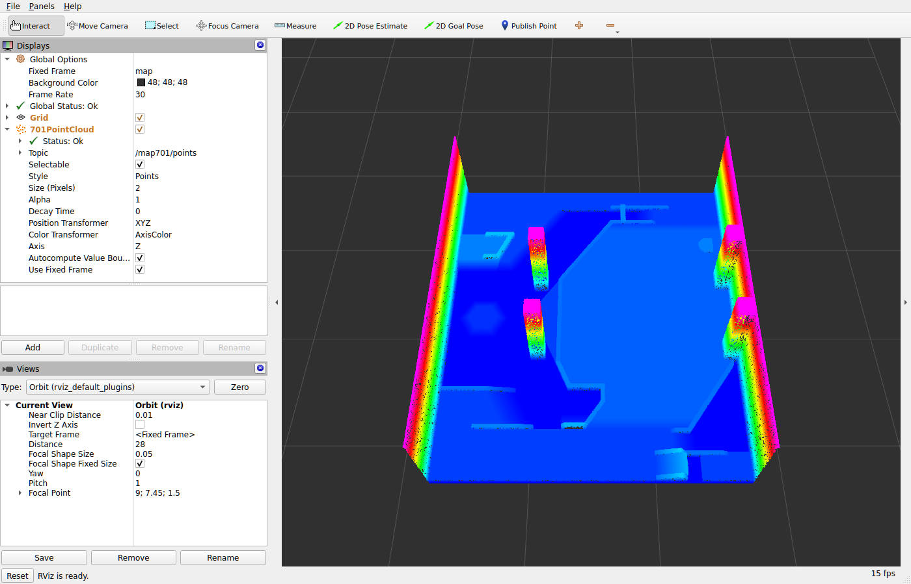

# 3.md —— 把 `map/701_model/map.pcd` 在 RViz2 里可视化

> 结论：**一条命令**即可看到 701 场地模型：`bash tools/view_map701.sh`。
> 本机（WSL2 + WSLg，`DISPLAY=:0`）实测通过：RViz `Global Status: Ok`、点云显示 `Status: Ok`、软件渲染下 8–31 fps（30 万点）。
> 除新增 `tools/` 目录外**没有动任何现有代码**（`git status`：仅 ` M .gitignore`（原有改动）+ `?? tools/`）。



---

## 0. 环境事实（先探明，决定方案）

| 项 | 实测值 | 影响 |
|---|---|---|
| ROS | `ROS_DISTRO=kilted`，`/opt/ros/kilted/setup.bash` | rviz2 走系统安装，不需要 colcon 编译 |
| `rviz2` | `/opt/ros/kilted/bin/rviz2` 存在 | 可用 |
| `pcl_ros` | **未安装**（`ros2 pkg list` 里只有 `pcl_conversions` / `pcl_msgs`） | **不能**用现成的 `ros2 run pcl_ros pcd_to_pointcloud`，需要自己解析 PCD 并发布 `PointCloud2` |
| python | `numpy 1.26.4`、`rclpy`、`sensor_msgs` 均可 import | 发布节点用纯 rclpy 实现，零编译 |
| 显示 | WSLg，`xdpyinfo` 1920x1080；`xwd -root` 直接失败（`BadMatch`） | 截图验证必须 `xwd -id <rviz 窗口 id>`，不能抓 root |

`map.pcd` 头部实测：

```
# .PCD v0.7
VERSION 0.7
FIELDS x y z          SIZE 4 4 4      TYPE F F F      COUNT 1 1 1
WIDTH 299854          HEIGHT 1        POINTS 299854
DATA binary
```

解析后实测范围：`x∈[1.445, 16.548]`、`y∈[1.065, 13.845]`、`z∈[0.100, 4.100]`，NaN 数 0（≈15 m × 13 m × 4 m 的场地扫描，`count=299854` 个点）。
注意这跟 `map/701_model/info.md` 里写的「场地范围 X/Y（-25 - 25）」不是一回事：**该 info 是转换前的场地坐标系，`map.pcd` 本身已经落在 Odin 起点系下（x/y 全为正）**，所以 RViz 里的默认视角必须对准 (9, 7.45, 1.5) 而不是原点。

---

## 1. 一条命令跑起来

```bash
cd /home/laf/robot_ws/sm_lst/SentryMaster2026
bash tools/view_map701.sh                 # 默认用 map/701_model/map.pcd
bash tools/view_map701.sh /path/other.pcd # 也可换别的 PCD
```

脚本做三件事（`tools/view_map701.sh`）：

1. `source /opt/ros/kilted/setup.bash`；
2. 后台跑 `tools/pcd_cloud_publisher.py`：把 PCD 发成 `/map701/points`（`PointCloud2`，`frame_id=map`）；
3. 后台跑 `ros2 run tf2_ros static_transform_publisher --frame-id world --child-frame-id map`（**仅为消除 RViz 的 Fixed Frame 警告**，见 §5），前台跑 `rviz2 -d tools/map701.rviz`；退出（Ctrl-C 关 RViz）时 `trap` 把两个后台进程一起收掉。

已实测在本机运行中：`rviz2 -d .../tools/map701.rviz` + `pcd_cloud_publisher.py` + `static_transform_publisher` 三个进程。

---

## 2. 实现步骤

### 步骤 1：解析 PCD（不引入 pcl）
`tools/pcd_cloud_publisher.py:load_pcd()`

- 按行读头部到 `DATA` 行为止，记录**数据起始字节偏移**（不能靠字符串搜 `DATA binary` —— 二进制数据里可能撞上同样的字节序列）；
- 由 `FIELDS/SIZE/TYPE/COUNT` 拼出 numpy 结构化 dtype；`_` 前缀字段、`COUNT>1` 用 `V<n>` / 子数组保留**原始字节布局**；
- `DATA binary`：`np.frombuffer(buf, dtype, count=POINTS)` —— **零拷贝**；
- `DATA ascii`：按列 `values[:, col]` 填结构化数组；`DATA binary_compressed` 直接报错退出（本文件用不到，不做半成品支持）；
- 按 `HEIGHT/WIDTH` reshape 成 `(height, width)`，与 `PointCloud2` 的行列语义对齐。

TYPE/SIZE → `PointField` datatype 的映射表 `_FIELD_TYPES`：`F4/F8` → `FLOAT32/FLOAT64`，`I1/I2/I4` → `INT8/INT16/INT32`，`U1/U2/U4` → `UINT8/UINT16/UINT32`。
**kilted 的 `sensor_msgs/PointField` 没有 `INT64/UINT64` 常量**（实测 `AttributeError`），所以 8 字节整型字段在这里直接判为不支持。

### 步骤 2：填 `PointCloud2`（关键是 `offset / point_step / row_step` 三者自洽）
`tools/pcd_cloud_publisher.py:PcdPublisher._build_msg()`

- `fields[].offset` 按实际内存布局累加（本例 `x=0, y=4, z=8`），`count` 与 PCD 的 `COUNT` 一致；
- `point_step = arr.dtype.itemsize`（本例 12）、`row_step = point_step * width`、`width=299854 / height=1`；
- `data = np.ascontiguousarray(arr).tobytes()` —— **一次整块内存直拷**，不逐点构造、不做循环拼接；
- `is_dense` 由 `x/y/z` 是否存在非有限值决定，不无脑写 `True`。

### 步骤 3：QoS 用 Transient Local + 周期重发
`PcdPublisher.__init__`：`RELIABLE + KEEP_LAST(depth=1) + TRANSIENT_LOCAL`，启动即发一次，之后按 `--rate`（默认 0.2 Hz，即 5 s）重发。

- `TRANSIENT_LOCAL`：**发布端先起、RViz 后起也能拿到那一帧**，不必等下一个周期。实测：发布端 `--rate 0`（**只发一次**）先跑 6 s，再启动 RViz，25 s 后截图里点云正常显示（233733 个彩色像素）→ 这一帧只可能来自 latched 缓存，证明耐久性设置生效；
- 周期重发（默认 0.2 Hz）是冗余保险：3.6 MB/5 s 可忽略，能兜住「首帧丢失 → 画面空白」。**实测过一次启动后画面只有网格没点云、重启后正常**，因此保留重发而不是只 latched 发一次。

### 步骤 4：写 RViz 配置
`tools/map701.rviz`（以 `/opt/ros/kilted/share/rviz_common/default.rviz` 为模板改）

| 配置项 | 值 | 理由 |
|---|---|---|
| `Fixed Frame` | `map` | 与发布端 `frame_id` 一致，同帧渲染无需 TF 查询 |
| Display | `rviz_default_plugins/PointCloud2`，`Name: 701PointCloud` | |
| `Topic` | `/map701/points`，`Durability: Transient Local`，`Reliability: Reliable` | 必须与发布端 QoS 匹配，否则收不到 |
| `Color Transformer` | `AxisColor` + `Axis: Z` | 只有 xyz 字段、没有 intensity，按高度上色最能看出墙体/坡道 |
| `Size (Pixels)` | `2` | 30 万点在 1400×900 窗口下够细、也不至于糊成一片 |
| `Autocompute Value Bounds` | `true`（Z 0.1–4.1） | 上色范围自动跟随实际高度 |
| `Grid` | `Cell Size 5`，`Alpha 0.3` | 只做尺度参考 |
| `Views/Current` | Orbit，`Focal Point 9, 7.45, 1.5`，`Distance 28`，`Pitch 1.0`，`Yaw 0` | 正好把 x∈[1.4,16.5]、y∈[1.1,13.8] 的整块场地框进画面（若照抄默认 `0,0,0 / Distance 10`，点云会在视野外，看着就像「没显示」） |

### 步骤 5：验证
见 §4。

---

## 3. 文件清单（全部为新增）

| 文件 | 作用 |
|---|---|
| `tools/pcd_cloud_publisher.py` | PCD → `PointCloud2` 发布节点（无编译、无 pcl 依赖） |
| `tools/map701.rviz` | 701 场地专用 RViz 配置 |
| `tools/view_map701.sh` | 一键启动：发布节点 + 静态 TF + RViz |
| `tools/map701_rviz_screenshot.png` | 本次实测截图（证据） |
| `3.md` | 本文 |

---

## 4. 验证证据（本次实测）

**消息层**：用一个独立 transient-local 订阅者读 `/map701/points`，实测输出

```
w,h 299854 1   point_step 12   row_step 3598248   len(data) 3598248   is_dense True
fields [('x', 0, 7, 1), ('y', 4, 7, 1), ('z', 8, 7, 1)]     # 7 = FLOAT32
frame map
first 3 pts [(5.869, 3.069, 0.295), (5.685, 3.148, 0.246), (5.331, 3.298, 0.209)]
last  pt   (13.365, 9.045, 0.400)
```

即 `row_step == len(data) == 3.6 MB`，字段偏移/步长自洽，首末点落在 §0 实测范围内。

**渲染层**：`xwd -id <rviz 窗口>` 抓图后统计 3D 渲染区像素 —— 只有 Grid 时为 13 种颜色、彩色像素 0；点云显示出来后有 **184k–196k 个高饱和像素**，截图中 RViz 面板为 `Global Status: Ok`、`701PointCloud → Status: Ok`、状态栏 `RViz is ready.`，可直接看到墙体（高、品红）、地面（低、蓝）与场地中的柱状/坡道结构。

**启动顺序两种都实测过**：

| 顺序 | 做法 | 结果（彩色像素数） |
|---|---|---|
| 先 RViz、后发布 | 先开 RViz 20 s（此时 0），再启动发布节点 8 s 后抓图 | 0 → **233733** |
| 先发布、后 RViz，且**只发一次** | `--rate 0` 先跑 6 s，再开 RViz 25 s 后抓图 | **233733**（只能来自 latched 帧） |

**反证（排除环境问题）**：用同样 12 字节步长、同样 QoS 的**合成** 20 万点云发到同一话题，同样能渲染出 184k 彩色像素 → 说明「不显示」不会来自 WSLg/软件 GL，而是与消息内容/字段布局有关，所以 §2 步骤 2 的三个步长必须自洽。

---

## 5. 踩到的坑（复现时会遇到）

| 坑 | 现象 | 处理 |
|---|---|---|
| `pcl_ros` 未安装 | `ros2 run pcl_ros pcd_to_pointcloud` 不存在 | 自写解析器，只用 `numpy` + `rclpy` |
| shell `set -u` | `source /opt/ros/kilted/setup.bash` 报 `AMENT_TRACE_SETUP_FILES: unbound variable`，后面 RViz 根本没起来 | `view_map701.sh` 用 `set -eo pipefail`，**不要 `-u`** |
| WSLg 抓屏 | `xwd -root` → `BadMatch`；Pillow `ImageGrab.grab()` → `X get_image failed` | 先 `xwininfo -root -tree` 拿 RViz 窗口 id，再 `xwd -id 0x...`，用自写的 XWD 解析（XWD 头 25 个大端 uint32 + colormap + 像素，按 RGB mask 还原）转 PNG |
| Fixed Frame 警告 | 只发点云时 `Global Status: Warn`（`map` 不在 TF 树里） | 启动脚本里加 `static_transform_publisher --frame-id world --child-frame-id map`；实测警告消失（`Global Status: Ok`） |
| 默认视角看不到 | 默认 `Focal Point 0,0,0 / Distance 10`，而点云在 x≈1.4–16.5 | 配置里写死 `Focal Point (9, 7.45, 1.5)`、`Distance 28` |
| QoS 不匹配 | 显示端若用默认 `Volatile`，与发布端 `Transient Local` 对不上可能收不到 latched 帧 | 两端都写 `Transient Local` + `Reliable`（已在 `.rviz` 里固定） |
| `PointField.INT64` | `AttributeError: type object 'PointField' has no attribute 'INT64'` | 8 字节整型字段不支持即可（本文件只有 `F F F / 4 4 4`） |

---

## 6. 常用改法

```bash
# 换话题名/坐标系
python3 tools/pcd_cloud_publisher.py src/sentry_planner/map/701_model/map.pcd \
        --topic /map701/points --frame-id map --rate 0.2

# 只发一次（不做周期重发）
python3 tools/pcd_cloud_publisher.py <map.pcd> --rate 0

# 收掉后台进程（脚本正常退出时会自动收）
pkill -f pcd_cloud_publisher.py; pkill -f static_transform_publisher; pkill -f 'rviz2 -d'
```

> 提示：`3.md`、`1.md`、`2.md` 都在根目录 `.gitignore` 的 `*.md` 规则里，不会被提交；`tools/` 是新目录，是否入库由你决定。
